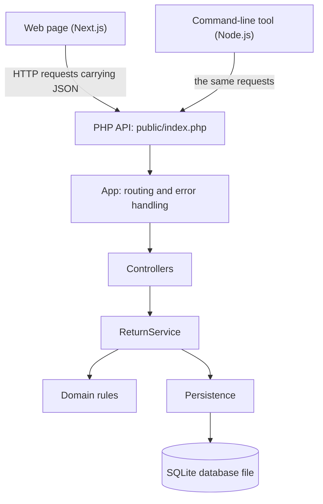
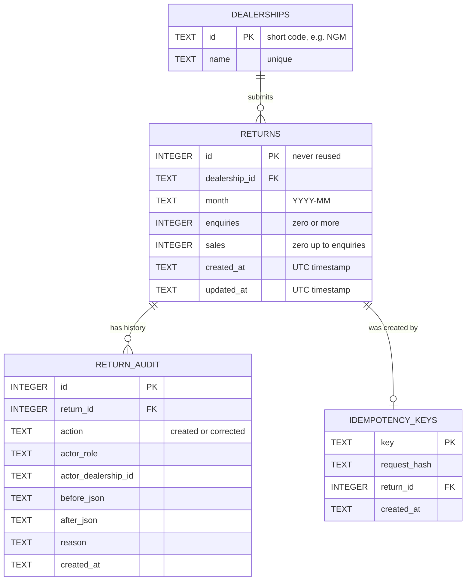
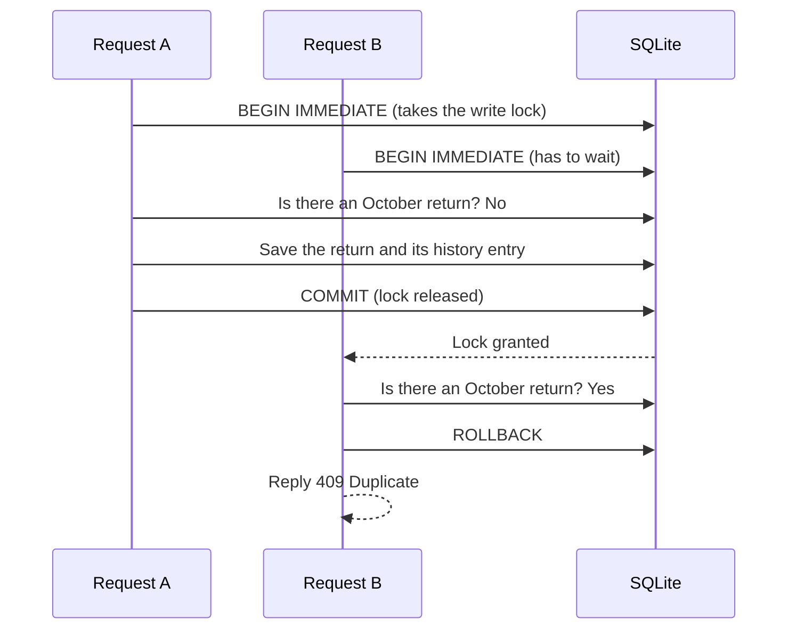
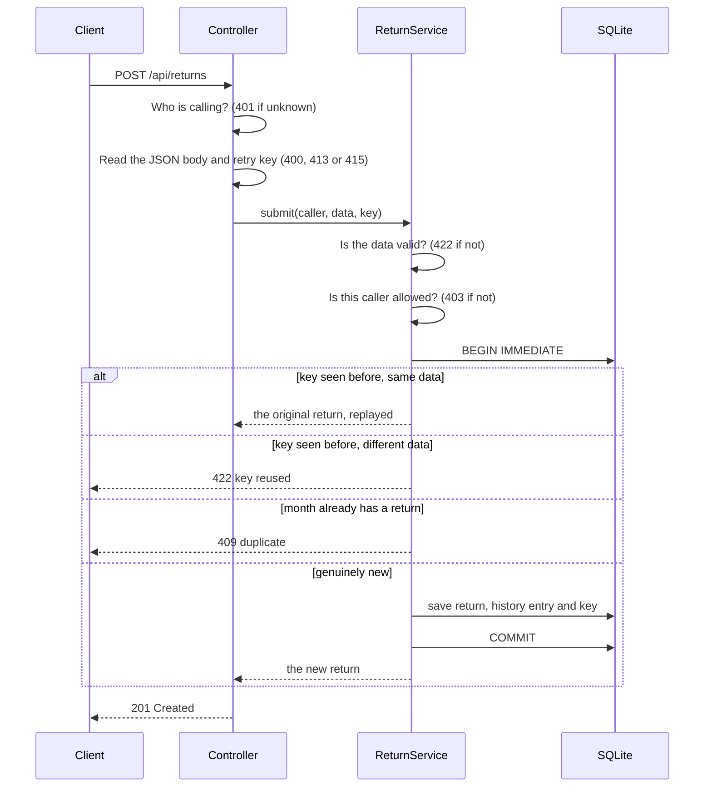
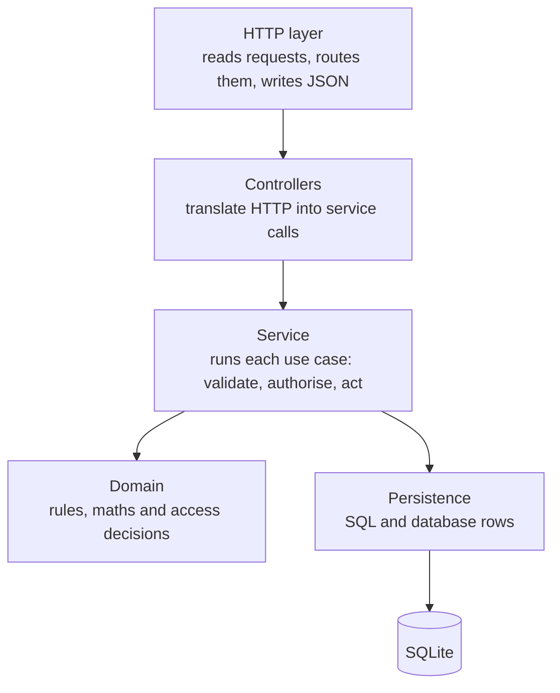
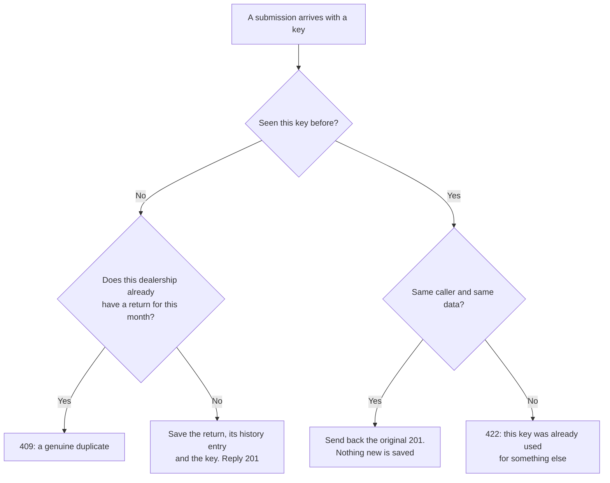

# How the Debonaire backend works

*A guide to the database and the PHP API behind the dealership reporting app*

## About this guide

This guide explains how the back end of the Debonaire dealership reporting app
is built. That means the SQLite database that stores the data, and the PHP code
that receives requests from the web page and the command-line tool. It is meant
to be read from start to finish. It assumes you are comfortable with basic
programming, but not necessarily with databases or with how PHP handles web
requests. When a technical term first appears it is explained in plain
English, and there is a glossary at the end if you want to look one up again.

Each section explains why the code is built the way it is, not just what it
does. Section 4 is an honest look at the strengths and weaknesses of the
design, and section 5 collects the questions an interviewer is most likely to
ask, with answers. Links point at the exact file and line in the repository,
so you can open the real code alongside the explanation.

Everything here was checked against the running system rather than written
from memory. The sample rows were read from the seeded database, and the
error messages in section 2.3 came from running the SQL against a copy of
that database.

---

## 1. The big picture

The application has three parts:

- a **web page** built with Next.js, where people enter and review returns;
- a **command-line tool** written for Node.js, which prints a summary for a
  chosen period;
- a **PHP API**, which sits between them and the database.

The web page and the command-line tool are both *clients*. Neither of them
ever touches the database. Whenever they need data, they send an HTTP request
to the PHP API, and the API is the only part of the system that reads from or
writes to the database.



One idea shapes almost every decision in the back end: **the server is the
only source of truth.** The page and the command-line tool never calculate
anything that gets stored or reported. They send the raw counts a user typed
in. In return they receive the saved rows, along with totals that the PHP
calculated from exactly those rows.

This matters for two reasons. First, a browser can be tampered with: someone
can open the developer tools and send any data they like, so nothing a browser
sends can be trusted. Second, if the page and the command-line tool each did
their own arithmetic, they could disagree, and the brief specifically asks
that they print the same figures.

The PHP code lives in the `api/` folder, and is organised into a handful of
sub-folders. Each one has a single job:

| Folder | What it contains |
|---|---|
| [`api/public/`](../api/public/index.php) | The only file the web server runs, `index.php`. Every request starts here. |
| [`api/src/Http/`](../api/src/Http) | Code that deals with HTTP: reading requests, routing them, and writing JSON responses. |
| [`api/src/Controller/`](../api/src/Controller) | Small classes that turn an HTTP request into a call to the service, and the result back into a response. |
| [`api/src/Service/`](../api/src/Service/ReturnService.php) | The use cases: listing, viewing, submitting and correcting returns, and showing their history. |
| [`api/src/Domain/`](../api/src/Domain) | The business rules: validation, the conversion-rate maths and the access rules. |
| [`api/src/Persistence/`](../api/src/Persistence) | Everything that talks to the database. |
| [`api/database/`](../api/database) | The database schema (`schema.sql`) and the script that loads sample data (`seed.php`). |
| [`api/tests/`](../api/tests) | The automated PHP tests. |

---

## 2. The database

### 2.1 Why SQLite?

SQLite is a database engine that keeps an entire database in one ordinary
file. In this project that file is `api/var/debonaire.sqlite`. Unlike MySQL
or PostgreSQL, there is no database server to install or run. PHP opens the
file directly.

The brief said either SQLite or "a simple file store" (for example, a JSON
file) would be acceptable, and it asked for an explanation of how the choice
affects concurrency and data integrity. SQLite was chosen for three reasons:

1. **Nothing to install.** Anyone assessing the exercise can run
   `npm run setup` and get a working database straight away.
2. **It is a real relational database.** It supports transactions and
   constraints. A transaction is a group of changes that either all happen or
   none do. A constraint is a rule the database enforces by itself. With a
   JSON file, every rule would have to live in PHP, and stopping two requests
   from overwriting each other would mean careful file locking.
3. **It is easy to move on from.** Almost everything in the schema translates
   directly to PostgreSQL or MySQL, so the design does not trap the project if
   it grows.

### 2.2 The four tables

A relational database stores data in tables, which are like spreadsheets with
strictly defined columns. This database has four.

- **`dealerships`** lists the dealerships that are allowed to report.
- **`returns`** holds the monthly figures.
- **`return_audit`** records every change ever made to a return.
- **`idempotency_keys`** makes it safe for a browser to retry a submission.
  That one is explained fully in section 3.6.

The diagram below shows how they connect. Each dealership can have many
returns, and each return can have many history entries.



The exact definitions are in
[`api/database/schema.sql`](../api/database/schema.sql). The rest of this
section goes through each table in turn.

#### The `dealerships` table

This is the simplest table. Each dealership has a short code as its
identifier, such as `NGM` for Northgate Motors, and a full name. The code is
the table's *primary key*: the value that uniquely identifies each row. Short
codes were chosen over numbers because they are readable wherever they
appear, whether in a URL, a request header or a command-line option. The
name column is marked `UNIQUE`, so the database will refuse a second
dealership with the same name.

These are the four rows the sample data creates:

| id | name |
|---|---|
| NGM | Northgate Motors |
| RVA | Riverside Autos |
| HBC | Harbour Cars |
| MLV | Meadow Lane Vehicles |

#### The `returns` table

This is the heart of the system. Each row is one dealership's figures for one
month.

| Column | Rule | Why |
|---|---|---|
| `id` | Primary key, `AUTOINCREMENT` | A number that identifies the return. `AUTOINCREMENT` guarantees a number is never reused, even if a row were deleted, so a history entry can never end up pointing at the wrong return. |
| `dealership_id` | Must match a row in `dealerships` | This is a *foreign key*. It stops a return being saved for a dealership that does not exist. It also stops a dealership being deleted while it still has returns. |
| `month` | Must look like `YYYY-MM` | Months are stored as text such as `2026-10`. Because the month always has two digits, these strings sort in date order, so a period filter can be a simple text comparison with no date arithmetic. |
| `enquiries` | A whole number, zero or more | The database checks the value really is an integer, not text or a decimal. |
| `sales` | A whole number from zero up to `enquiries` | The spec says sales are conversions of the same enquiries, so a dealership cannot sell more cars than it had enquiries. This rule is written into the database itself. |
| `created_at`, `updated_at` | Text timestamps in UTC | SQLite has no dedicated date type. Timestamps are written in the standard ISO-8601 form (for example `2026-11-03T09:30:00Z`), which sorts correctly and is unambiguous. |

The table also has one rule that spans two columns:
`UNIQUE (dealership_id, month)`. It means **a dealership can only ever have
one return for a given month.** This is how the spec's "reject a second
return for the same dealership and month" is enforced at the deepest level.
Section 2.6 explains why that matters when two requests arrive at the same
moment.

These are the first few rows the sample data creates:

| id | dealership_id | month | enquiries | sales | created_at | updated_at |
|---|---|---|---|---|---|---|
| 1 | NGM | 2026-06 | 412 | 97 | 2026-07-03T09:30:00Z | 2026-07-03T09:30:00Z |
| 2 | NGM | 2026-07 | 389 | 88 | 2026-08-03T09:30:00Z | 2026-08-03T09:30:00Z |
| 3 | NGM | 2026-09 | 450 | 121 | 2026-10-03T09:30:00Z | 2026-10-03T09:30:00Z |
| 4 | NGM | 2026-10 | 431 | 104 | 2026-11-03T09:30:00Z | 2026-11-03T09:30:00Z |

There is no column for the conversion rate. That is deliberate. The rate is
always calculated from the counts whenever it is read, so a stored rate can
never fall out of step with the numbers it was supposedly based on.

#### The `return_audit` table

Every time a return is created or corrected, a row is added here describing
what happened. Each row records:

- **which return** changed, and **what kind of change** it was (`created` or
  `corrected`);
- **who made it**: their role (`dealer`, `manager`, or `seed` for the sample
  data) and, for a dealer, their dealership;
- **the figures before and after**, stored as small pieces of JSON such as
  `{"enquiries":14,"sales":3}`;
- **the reason** given for a correction;
- **when** it happened.

The PHP code only ever adds rows to this table. It never edits or deletes
them, so the full history of any return can always be replayed. These are the
first two rows the sample data writes:

| id | return_id | action | actor_role | before_json | after_json | reason | created_at |
|---|---|---|---|---|---|---|---|
| 1 | 1 | created | seed | *empty* | `{"enquiries":412,"sales":97}` | *empty* | 2026-07-03T09:30:00Z |
| 2 | 2 | created | seed | *empty* | `{"enquiries":389,"sales":88}` | *empty* | 2026-08-03T09:30:00Z |

The "before" column is empty for a creation, because there was nothing there
before. The reason is empty because only corrections need one.

#### The `idempotency_keys` table

When the web page submits a return, it attaches a random identifier called an
*idempotency key*. This table remembers each key, a fingerprint of the
request it arrived with, and the return that request created. If the same
request is sent again (for example, because the connection dropped and the
browser retried), the API recognises the key and hands back the original
result instead of saving anything twice. Section 3.6 explains this in detail.

### 2.3 Rules the database enforces on its own

The PHP code checks every piece of incoming data before it goes anywhere near
the database. The most important rules are written into the database as well.
This approach is called *defence in depth*: if a bug ever crept into the PHP
validation, the database would still refuse to store bad data.

To prove that, a series of deliberately bad `INSERT` statements was run
directly against a copy of the database using the `sqlite3` command-line
tool, completely bypassing PHP. This is what happened:

| What was attempted (directly in SQL) | What the database did |
|---|---|
| A second return for Northgate Motors in June 2026 | Refused: `UNIQUE constraint failed: returns.dealership_id, returns.month` |
| 5 enquiries but 9 sales | Refused: the sales check failed |
| Minus one enquiry | Refused: the enquiries check failed |
| 5.5 enquiries | Refused: the value is not an integer |
| The text `abc` as enquiries | Refused: the value is not an integer |
| The month written as `Oct 2026` | Refused: the month check failed |
| A return for a dealership called `ZZZ` | Refused: `FOREIGN KEY constraint failed` |
| Deleting Northgate Motors, which has returns | Refused: `FOREIGN KEY constraint failed` |
| The month `2026-19` | **Accepted** |
| The text `'5'` as enquiries | **Accepted, and stored as the number 5** |

The last two rows show two genuine gaps in the database's own safety net.

The month check uses a pattern that only looks at the *shape* of the text:
four digits, a dash, then a 0 or 1 followed by any digit. That is enough to
reject `Oct 2026`, but it also lets through `2026-00` and `2026-13` up to
`2026-19`.

The text `'5'` gets through because of how SQLite handles column types. A
column declared as `INTEGER` quietly converts text that looks like a number
into a real number before any check runs. So by the time the check asks "is
this an integer?", the answer is already yes.

Neither gap can be reached through the API. The PHP month parser only accepts
months 01 to 12, and the PHP validator only accepts true JSON numbers, not
text. So the system as a whole behaves correctly, but the database's backup
layer is not quite as strict as it could be. Section 4.1 describes the simple
fixes.

### 2.4 Indexes: keeping lookups fast

An *index* is a sorted lookup structure the database keeps alongside a table,
much like the index at the back of a book. Without one, finding Riverside
Autos' October return would mean reading every row. With one, the database
can jump straight to it. There are four.

The **`UNIQUE (dealership_id, month)`** rule automatically creates an index,
which SQLite names `sqlite_autoindex_returns_1`. It does double duty: it
enforces the one-return-per-month rule, and it speeds up both the duplicate
check and any filter by dealership. It helps with dealership filters because
the dealership is the first column in the index.

A separate index on **`month`** (`returns_month_idx`) speeds up period filters
when no dealership is chosen.

An index on **`return_audit.return_id`** makes it quick to load the history of
a single return.

Finally, the **primary key on `idempotency_keys`** makes looking up a retry
key instant.

### 2.5 How the API connects to the database

PHP talks to databases through a built-in layer called **PDO** (PHP Data
Objects), which works the same way whatever database sits behind it. Every
request opens one connection in
[`Database::open`](../api/src/Persistence/Database.php#L36) and applies a few
settings.

**Errors are turned into exceptions.** By default, PDO can fail quietly and
leave the code to check a return value. With this setting, every SQL error
stops the code with an exception, so nothing can go wrong silently.

**Rows come back as named arrays, and numbers come back as numbers.** PDO is
told to return each row as `['enquiries' => 412, …]` and not to turn
integers into strings. Without that, the code would have to convert `"412"`
back into `412` everywhere.

**Foreign keys are switched on.** This one is easy to miss: SQLite ignores
foreign-key rules unless every connection explicitly turns them on with
`PRAGMA foreign_keys = ON`. A *pragma* is SQLite's word for a connection
setting. Without this line, the "dealership must exist" rule from section 2.2
would silently do nothing.

**A busy database makes requests wait rather than fail.** SQLite lets only one
request write at a time. The `busy_timeout` of 5,000 milliseconds means that
if another request is writing, this one waits up to five seconds for its turn
instead of failing straight away.

**Write-ahead logging is enabled.** With `journal_mode = WAL`, new changes are
written to a side file first. That lets other requests keep reading the last
saved state while a write is in progress, so reading and writing don't block
each other. The setting is stored in the database file itself.

Finally, every query in the code uses **prepared statements**. The SQL is
written with placeholders such as `:month`, and the actual values are passed
separately. The database never mixes user input into the SQL text, which makes
*SQL injection* (tricking a database into running commands hidden in user
input) impossible through any of the API's inputs.

### 2.6 Transactions, and how duplicates are prevented

A **transaction** groups several database changes so they succeed or fail as
one unit. If anything goes wrong halfway through, everything is undone (*rolled
back*), and the database is left exactly as it was. Every write in this
project goes through one method,
[`Database::transaction`](../api/src/Persistence/Database.php#L83), which
starts the transaction, runs the work, and either *commits* (saves) or rolls
back.

Transactions also solve a subtle problem called a **race condition**. Imagine
two people at Riverside Autos press Submit for October at the same moment.
Both requests ask the database "is there already an October return?", both
hear "no", and both go on to save one. Now there are two.

The fix is in how the transaction starts. A normal `BEGIN` only claims
SQLite's write lock when the first change is actually made, which is too late,
because both requests have already done their check. This code uses
**`BEGIN IMMEDIATE`**, which claims the write lock before doing anything else.
The second request therefore has to wait until the first has finished and
saved. When it finally runs its check, it sees the return the first request
created, and it refuses with a "duplicate" error.



The `UNIQUE` rule from section 2.2 is still there as a backstop. If some
future code ever tried to insert a return without doing the check first, the
database would refuse it. The repository's
[`insert`](../api/src/Persistence/ReturnRepository.php#L100) method catches
that specific refusal and turns it into the same friendly duplicate message,
so the user never sees a raw database error.

This is tested for real. One of the integration tests fires ten identical
submissions at the server simultaneously. It checks that exactly one
succeeds, the other nine are refused as duplicates, and only one row ends up
in the database. It passed on every repeated run.

### 2.7 Creating the tables and loading sample data

There is no separate *migration* tool (software that applies numbered schema
changes in order). Instead,
[`schema.sql`](../api/database/schema.sql) writes every table and index as
`CREATE … IF NOT EXISTS`, which does nothing if the table is already there.
That makes the file safe to run any number of times, and the API runs it at
the start of every request. A fresh checkout therefore always ends up with
the right tables, with no extra step. The cost of doing it on every request
is small but real, as section 4 discusses.

The sample data is loaded by the [`Seeder`](../api/src/Persistence/Seeder.php)
class (run with `npm run seed`). It creates four dealerships and ten returns,
chosen so that every reporting edge case in the brief can be seen:

| Dealership | June | July | August | September | October | What it demonstrates |
|---|---|---|---|---|---|---|
| Northgate Motors | 412 / 97 | 389 / 88 | none | 450 / 121 | 431 / 104 | A busy dealership |
| Riverside Autos | 128 / 31 | 140 / 29 | none | 117 / 22 | *free* | A mid-sized one, with October left free to submit in a demo |
| Harbour Cars | 14 / 3 | **0 / 0** | none | 9 / 2 | none | A small one, including a month with **zero enquiries** |
| Meadow Lane Vehicles | none | none | none | none | none | A dealership with no returns at all |

Each cell shows enquiries / sales for 2026. August 2026 has no returns at
all, for anyone, which covers the brief's "another month has no returns"
case.

Running the seeder twice is harmless. It uses `INSERT OR IGNORE`, which skips
rows that already exist, and it counts how many rows were actually added.
Each sample return also gets a `created` history entry, attributed to `seed`.
The timestamps are fixed (half past nine, UTC, on the 3rd of the following
month), which is why the duplicate message for a seeded return always says
"submitted 3 Nov 2026" or similar. To start again from scratch,
`npm run seed:fresh` deletes the database file and rebuilds it.

### 2.8 What gets written when someone submits or corrects a return

When a manager submits Riverside Autos' October figures with an idempotency
key, three rows are written inside a single transaction:

| Table | What is written |
|---|---|
| `returns` | A new row: id 11, Riverside Autos, October 2026, 131 enquiries and 27 sales, with the created and updated times both set to now. |
| `return_audit` | A `created` entry for return 11, made by a manager, with no "before" figures and "after" figures of 131 enquiries and 27 sales. |
| `idempotency_keys` | The key the page sent, a fingerprint of the request, and a pointer to return 11. |

(The id is illustrative; the database assigns the next free number.)

When a manager corrects Harbour Cars' June return from 14 enquiries and 3
sales to 16 and 4, two things happen, again in one transaction. The return's
figures and `updated_at` time are updated, and a history row is added. That
row records the old figures, the new figures, who made the change and the
reason they gave.

Because the update and its history entry share a transaction, **it is
impossible for a return to change without the change being recorded.**
Either both are saved, or neither is.

### 2.9 Dates and time zones

All stored timestamps are in UTC (the `Z` on the end means exactly that). The
one question where local time matters is "which month is it now?", because a
return for a future month is not allowed. That question is answered in UK
time ([`Month::current`](../api/src/Domain/Month.php#L53)). At half past
eleven at night UTC on 31 May, it is already 1 June in the UK during British
Summer Time, so June counts as the current month. A unit test checks exactly
that case.

The current time is never read directly from the computer's clock inside the
business code. It comes from a small `Clock` object passed in from outside, so
the tests can freeze time at a known moment. This stops tests from passing
today and failing next month.

---

## 3. How the PHP works

### 3.1 How PHP runs a web request

PHP works differently from most server languages. It **starts from scratch for
every request**: it runs the script, sends the response, and forgets
everything. Nothing is kept in memory between one request and the next. This
is often described as *share-nothing*. It makes PHP very predictable, because
one request can never be affected by leftovers from another.

In development, the API runs on PHP's built-in web server:

```bash
php -S 127.0.0.1:8000 public/index.php
```

Naming `public/index.php` on the end makes that file the **front controller**:
every request, whatever its URL, is handed to that one script. It is the
single entry point, and it decides what to do with each request.

### 3.2 Following one request from start to finish

This section follows a single request through the system, step by step.

**Step 1: the front controller.**
[`public/index.php`](../api/public/index.php) loads Composer's autoloader,
which finds class files automatically when they are first used. It then does
everything in one line: build the application, read the request, handle it,
and send the response.

**Step 2: reading the request.**
[`Request::fromGlobals`](../api/src/Http/Request.php#L34) gathers everything
PHP knows about the incoming request into one tidy, unchangeable object: the
method (GET, POST and so on), the path, the query string, the headers and the
raw body. PHP normally scatters these across global variables such as
`$_SERVER` and `$_GET`. Nothing after this point reads those globals, which
keeps the rest of the code easy to test.

**Step 3: building the application.**
[`App::fromEnvironment`](../api/src/App.php#L52) reads the configuration
settings. It opens the database (applying the settings from section 2.5),
makes sure the tables exist, and decides whether to use the real clock or a
frozen test clock. [`App::build`](../api/src/App.php#L76) then creates every
object the API needs, connects them together by hand, and registers the
routes, which map URLs to the code that handles them.

**Step 4: handling the request safely.**
[`App::handle`](../api/src/App.php#L111) first checks for a CORS
*preflight*. That is a permission check browsers send before certain
cross-site requests (explained in section 3.4), and it is answered at once.
Every other request goes to the router. Crucially, this method **catches any
error at all** and turns it into a proper JSON response, so the API can never
crash with a raw PHP error page.

**Step 5: routing.**
[`Router::dispatch`](../api/src/Http/Router.php#L32) compares the method and
path with the registered routes and calls the matching handler. A
placeholder such as `{id}` in a route only matches positive whole numbers, so
`/api/returns/abc` gets a "not found" reply before any database code runs. If
the path exists but the method is wrong (say, DELETE on a return), the router
replies "405 Method Not Allowed" and lists the methods that are allowed,
rather than a misleading "not found".

**Step 6: the controller.**
The controller works out who is calling (section 3.4 explains how), reads the
body or query string, and passes everything to the service.

**Step 7: the service does the work.**
Every operation in [`ReturnService`](../api/src/Service/ReturnService.php)
follows the same three steps. It *validates* the input, it checks the caller
is *allowed* to do this, and then it *does the work*. Anything that changes
data runs inside a transaction.

**Step 8: the response.**
The controller wraps the result in a JSON response. The CORS code adds the
headers the browser needs, and the response is sent.

The diagram below shows the busiest route, submitting a new return, including
each way it can end. The checks the controller and service make are shown as
steps, with the error each one returns if it fails.



### 3.3 Why the code is split into layers

The code is arranged in layers. Each layer only deals with one kind of
concern and only calls the layer below it.



The most important boundary is that **the domain knows nothing about HTTP or
SQL.** The validation rules, the conversion-rate maths and the access rules
are plain PHP that takes values in and gives answers back. That means they
can be tested in milliseconds, with no web server and no database. Likewise,
the controllers contain no business rules, and the database code makes no
business decisions. It only reports facts, such as "this would be a
duplicate".

| Layer | Its job | What it must not do |
|---|---|---|
| HTTP | Read requests, route them, write JSON, handle CORS and the demo identity | Contain business rules |
| Controllers | Turn a request into a service call, and the result into a status code and headers | Check permissions or validate fields themselves |
| Service | Run a use case from start to finish | Know about HTTP status codes |
| Domain | Hold the rules, the maths and the access decisions | Touch the database or HTTP |
| Persistence | Run SQL and turn rows into objects | Decide business outcomes |

### 3.4 The important classes, one by one

#### `Request`: reading the body safely

[`Request::jsonObject`](../api/src/Http/Request.php#L69) is the only way any
code reads a request body, and it is deliberately strict:

- The body must be labelled as JSON (`Content-Type: application/json`).
  Otherwise the reply is "415 Unsupported Media Type".
- It must be no larger than 16 KB. Otherwise the reply is "413 Payload Too
  Large".
- It must be valid JSON, nested no more than eight levels deep. Otherwise the
  reply is "400 Bad Request".
- It must be a JSON *object* (curly braces), not a list.

The last rule needs a small trick. PHP's usual way of decoding JSON turns
both `{"a": 1}` and `[1]` into the same kind of PHP array, so you can't tell
them apart afterwards. The code therefore decodes into objects first, checks
it really received an object, and only then converts it to an array.

#### `Router`: matching URLs to code

The router is about sixty lines long. Each route is a method plus a path
pattern, such as `GET /api/returns/{id}`, and the pattern is turned into a
regular expression when the route is registered. When a path matches but the
method doesn't, the router remembers which methods *would* have matched, so
it can reply with "405 Method Not Allowed" and an `Allow` header listing
them.

#### `MockIdentity`: a stand-in for logging in

The brief says authentication is "discussion only", so there is no real
login. Instead, the caller says who they are in two request headers:
`X-Debonaire-Role` (either `dealer` or `manager`), and, for a dealer,
`X-Debonaire-Dealership` naming their dealership. The web page's "Viewing as"
menu sets these headers.

This is clearly **not** security, because anyone can send any header, and the
code says so in comments marked `MOCK AUTH (F9)` wherever it is involved. It
does, however, *fail closed*. If the headers are missing or name an unknown
role or dealership, the request is refused with "401 Unauthorised". It is not
quietly given a default role. In a real system, this one class would be
replaced by code that checks a signed login token, and nothing else would
need to change.

#### `ReturnsController`: thin on purpose

The controller only handles HTTP details. On success it replies "201 Created"
with a `Location` header giving the new return's address. When a retry is
recognised, it adds an `Idempotent-Replayed: true` header. It also checks
that a retry key looks sensible: 8 to 128 letters, digits, dashes or
underscores. That stops junk from being stored. Everything else is handed to
the service.

#### `ReturnService`: where the use cases live

[`ReturnService`](../api/src/Service/ReturnService.php) has one method per use
case.

[**Listing returns**](../api/src/Service/ReturnService.php#L65) validates the
filter (a start month, an end month and optionally a dealership) and narrows
it to the caller's own dealership if they are a dealer. It then fetches the
matching rows and calculates the totals **from exactly those rows**. That
last point guarantees that the table and the totals on the page can never
disagree.

[**Submitting a return**](../api/src/Service/ReturnService.php#L106) is shown
in the diagram in section 3.2.

[**Correcting a return**](../api/src/Service/ReturnService.php#L178) runs four
steps:

1. Check the caller is a manager.
2. Validate the new figures and the reason.
3. Inside a transaction, load the return. If it doesn't exist, reply "404".
   If the "correction" doesn't actually change anything, refuse it, so the
   history doesn't fill up with pointless entries.
4. Save the new figures together with the history entry.

[**Viewing the history**](../api/src/Service/ReturnService.php#L220) checks
the caller is a manager and that the return exists, then returns its history
entries, oldest first.

#### `ReturnValidator`: every rule, every message

[`ReturnValidator`](../api/src/Domain/ReturnValidator.php) checks each field
and collects **all** the problems before replying. The user sees everything
that needs fixing at once, rather than fixing one error only to be shown the
next. The messages are written for the person filling in the form, not for a
developer:

| The problem | The message the user sees |
|---|---|
| A field the server doesn't accept, such as `totals` | Unexpected field "totals". Only dealershipId, month, enquiries, sales are accepted; totals and rates are always calculated by the server. |
| No dealership | Dealership is required. |
| A dealership that doesn't exist | Unknown dealership "ZZZ". |
| A badly written month | Month must be in YYYY-MM format, e.g. 2026-03. |
| A month in the future | Month cannot be in the future. The latest month you can report is 2026-11. |
| A count that isn't a whole number | Enquiries must be a whole number. |
| A negative count | Enquiries cannot be negative. |
| A count over one million | Enquiries cannot be more than 1,000,000. |
| More sales than enquiries | Sales (11) cannot be more than enquiries (10), because sales are conversions of those enquiries. |

Several decisions here are worth knowing about.

**The validator is strict about numbers.** It rejects `"5"` (the number sent
as text) and even `5.0`. PHP reads `5.0` as a decimal, which suggests the
sender isn't really sending whole numbers.

**It only compares sales with enquiries once both are valid on their own.**
Otherwise a bad enquiries figure would produce a second, confusing error
about sales.

**Corrections have their own rules.** They may only change the enquiries and
sales, and they must include a reason. Trying to change the dealership or the
month gets a specific explanation, because those two values identify the
return.

**The one-million limit is an assumption.** The brief doesn't ask for it. It
is there to catch typos such as an extra zero, and the README says so.

#### `Month`: one tiny but important detail

Months are checked with the pattern `/^(\d{4})-(0[1-9]|1[0-2])\z/`. The `\z`
at the end matters. In PHP's regular expressions, the more common `$` also
matches just before a trailing line break, so `"2026-03"` followed by a
newline would slip through. `\z` means "the very end of the text, full stop".
A unit test covers this case.

#### `ReportCalculator`: the conversion-rate maths

The overall conversion rate is **pooled**: total sales divided by total
enquiries. It is not the average of each dealership's rate. The difference
matters a lot when dealerships are different sizes. Suppose one dealership
converts 10% of 400 enquiries and another converts 100% of just 4. Averaging
the two rates would claim 55%, which badly overstates how the business is
doing. The pooled rate is 44 sales out of 404 enquiries, or 10.89%.

Rounding is done with **whole numbers only**. The rate is first calculated in
*basis points*, where one basis point is a hundredth of a percent, and then
divided by 100 at the end
([`conversionBasisPoints`](../api/src/Domain/ReportCalculator.php#L29)):

```text
basis points = (sales × 10000 × 2 + enquiries) ÷ (enquiries × 2), rounded down
rate         = basis points ÷ 100
```

That slightly odd formula is just a way of rounding to the nearest hundredth
of a percent, with exact halves rounded up, using whole-number division. It
avoids decimal (floating-point) arithmetic because computers store most
decimals approximately. PHP and JavaScript can then round the same number
differently, so the page and the command-line tool could disagree in the
last digit. These examples show the formula at work:

| Sales and enquiries | Exact rate | Shown as | Why it's interesting |
|---|---|---|---|
| 497 of 2,090 | 23.7799…% | 23.78% | The total for all the sample data |
| 1 of 32 | 3.125% | 3.13% | An exact half, rounded up |
| 201 of 20,000 | 1.005% | 1.01% | JavaScript's usual rounding gets this one wrong and shows 1.00% |
| 0 of 0 | undefined | N/A | No enquiries means no rate, which is not the same as 0% |

The TypeScript copy of this formula, used by the command-line tool, does
exactly the same calculation. Both the PHP tests and the TypeScript tests
read the same sixteen test cases from one shared file,
`fixtures/conversion-cases.json`. That proves the two languages always agree.

#### `AccessPolicy`: who may do what

All of the permission rules live in one class,
[`AccessPolicy`](../api/src/Domain/AccessPolicy.php). Nowhere else in the
code compares roles, so the whole access model can be read in one place:

| Action | A dealer | A manager |
|---|---|---|
| See the list of dealerships | Only their own | All of them |
| List returns | Only their own; asking for another dealership is refused | All of them, with optional filters |
| View a single return | Only their own | Any |
| Submit a return | Only for their own dealership | For any dealership (for example, when keying in a paper return) |
| Correct a return | Not allowed | Allowed |
| View a return's history | Not allowed | Allowed |

One subtle point is how a dealer's list is handled
([`scopeFilter`](../api/src/Domain/AccessPolicy.php#L58)). If a dealer doesn't
name a dealership, the filter is quietly narrowed to their own, so leaving the
filter out can never reveal anyone else's data. If a dealer explicitly asks
for a *different* dealership, the request is refused rather than quietly
changed. That way a bug in a client shows up as an error, instead of as
figures that look right but aren't what was asked for.

#### `JsonResponse`: a consistent reply format

Every error the API returns has the same shape. Whoever is calling only needs
one way of reading errors:

```json
{ "error": { "code": "validation_failed", "message": "…", "fields": { "sales": "…" } } }
```

Every response is also marked as not to be cached, and as JSON only, so a
browser never stores or misreads it. One small detail was caught by the
tests. PHP normally writes the number 25.0 as plain `25`, which made a 25%
rate look like a whole number while 23.78% looked like a decimal. The
`JSON_PRESERVE_ZERO_FRACTION` option keeps it as `25.0`, so the rate is always
the same kind of value.

#### `Cors`: letting the web page talk to the API

The web page runs at one address (port 3000) and the API at another (port
8000). Browsers block a page from reading responses from a different address
unless that server explicitly allows it. The rules for granting that
permission are called **CORS** (Cross-Origin Resource Sharing). The API keeps
a list of allowed addresses, and only those receive the permission headers.

For requests with custom headers, such as the identity headers, the browser
first sends a quick "is this allowed?" request, called a *preflight*. The API
answers it with a list of the permitted methods and headers. The API also
tells the browser it may read the `Location` and `Idempotent-Replayed`
response headers, which browsers otherwise hide from page code.

#### `App`: wiring it all together

[`App`](../api/src/App.php) creates and connects all the objects by hand. A
project this size doesn't need a *dependency-injection container* (a library
that does this wiring automatically), and wiring it by hand means you can
read exactly how everything fits together in one short method. `App` also
contains [`errorResponse`](../api/src/App.php#L129), the single place where
problems are turned into HTTP status codes, which is the subject of the next
section.

### 3.5 How errors become HTTP responses

Every HTTP response carries a three-digit *status code* that tells the
caller, in a standard way, what happened. Codes in the 200s mean success,
the 400s mean the caller did something wrong, and the 500s mean the server
failed.

The business code never deals with these numbers directly. When a rule is
broken, it throws a named exception, such as "validation failed" or "this
return already exists". [`App::errorResponse`](../api/src/App.php#L129)
translates each one into the right status code. Keeping that translation in
one place means the rules don't need to know they're being used over HTTP,
and the codes stay consistent.

| What went wrong | Status code | Error code in the reply |
|---|---|---|
| A broken request: bad JSON, wrong content type, too large, unknown address or wrong method | 400, 413, 415, 404 or 405 | e.g. `invalid_json` |
| The caller didn't say who they are | 401 | `missing_identity` |
| The caller isn't allowed to do this | 403 | `forbidden` |
| The return doesn't exist | 404 | `not_found` |
| A return already exists for that dealership and month | 409 | `duplicate_return`, plus a copy of the existing return |
| The data broke a validation rule | 422 | `validation_failed`, plus a message for each field |
| A retry key was reused for different data | 422 | `idempotency_key_reused` |
| Anything unexpected | 500 | `internal_error` |

For unexpected errors, the full details are written to the server's log, but
the caller only receives a polite generic message. Internal details such as
SQL or file paths are never revealed.

### 3.6 Idempotency: making retries safe

*Idempotent* means "doing it twice has the same effect as doing it once". It
matters because of a specific, real-world problem the brief raises. Suppose
someone submits a return, the server saves it, but the connection drops
before the reply reaches the browser. The user sees an error and presses
Submit again. Without protection, the second attempt would be told "this
return already exists". That is technically true, but it is confusing,
because as far as the user knows, their first attempt failed.

The fix works like this. When the user presses Submit, the web page creates a
random identifier (a UUID) and sends it with the request in an
`Idempotency-Key` header. If the user retries **with the same data**, the page
sends **the same key**. If they change anything, a new key is created. The
server's decision then follows this diagram:



The "same caller and same data" check uses a *hash*: a short fingerprint
calculated from who sent the request and exactly what it contained. If even
one figure differs, the fingerprint differs, and the server treats the reuse
of the key as a mistake rather than a retry.

This is tested end to end in a real browser. The test lets the first
submission reach the server but deliberately throws away the reply. It then
presses Submit again and checks that the page shows success and that exactly
one return exists.

### 3.7 Settings

The API reads a few optional settings from environment variables, so the same
code can run in development, in tests and in the end-to-end suite without
changes:

| Setting | Default | What it controls |
|---|---|---|
| `DEBONAIRE_DB` | `api/var/debonaire.sqlite` | Which database file to use. The tests and the end-to-end suite each use their own file. |
| `DEBONAIRE_ALLOWED_ORIGINS` | The two local web-page addresses on port 3000 | Which web addresses CORS allows. |
| `DEBONAIRE_FIXED_NOW` | Not set, so the real clock is used | Freezes the current time, which only the tests use. |
| `PHP_CLI_SERVER_WORKERS` | 4 in this project's scripts | How many requests PHP's built-in server can handle at once. The concurrency test needs more than one. |

### 3.8 How the PHP is tested

There are two PHP test suites, both written with PHPUnit, the standard PHP
testing tool.

The **unit tests** (107 of them) test the domain classes on their own, with
no web server and no database. They cover every validation rule and message,
month parsing and UK time, all sixteen shared conversion-rate cases, and the
full access-control table. Because the domain doesn't depend on the database,
the whole suite runs in a fraction of a second.

The **integration tests** (62 of them) test the API as a real client would.
The shared setup class,
[`ApiTestCase`](../api/tests/Integration/ApiTestCase.php), does the
following:

- starts PHP's built-in server with the real front controller, on a free
  port;
- gives it a temporary database file, a frozen clock and four workers;
- resets the data to the sample set before **every** test, so tests can't
  affect each other;
- makes real HTTP requests, including ten simultaneous ones for the
  concurrency test;
- shuts the server down cleanly afterwards.

Nothing is faked: routing, JSON handling, CORS, database constraints and
transactions all run for real.

On top of these, the project has TypeScript tests for the web page and the
command-line tool. It also has a Playwright suite, which drives a real
browser against the real page, API and database, and checks among other
things that the page and the command-line tool print identical figures.

### 3.9 Conventions you'll see in the code

**Strict typing.** Every PHP file starts with `declare(strict_types=1)`, which
stops PHP from silently converting values between types. Classes are marked
`final`, so they can't be extended unexpectedly, and their properties are
`readonly`, so they can't be changed after creation. The role is a proper
`enum` (a fixed set of named values) rather than loose strings.

**Feature labels in the comments.** Every file opens with a comment naming the
feature it implements, using labels F1 to F14 from the project's spec
document, and the section of the brief it relates to. The same labels appear
in test names and commit messages. Together they let you trace any
requirement from the brief, to the code, to its tests, to the commit that
added it.

**Comments explain why, not what.** They sit at the point where each rule is
enforced. For example: *"Sales are conversions of the same enquiries, so they
can never exceed them."* Comments that merely repeat what the code says are
avoided.

---

## 4. Strengths and weaknesses

### 4.1 The database

#### Strengths

**Data integrity is enforced twice.** The PHP checks everything first, and the
database independently rejects duplicates, sales above enquiries, negative or
non-whole counts, badly formed months and returns for unknown dealerships.
Section 2.3 showed this working with real SQL.

**The duplicate race is genuinely solved, not just made unlikely.**
`BEGIN IMMEDIATE`, backed by the `UNIQUE` rule, means two simultaneous
submissions can never both succeed. A test proves it with ten requests at
once.

**Nothing derived is stored.** Conversion rates are always calculated from the
counts when read, so they can never go stale or disagree with the counts.

**The history can't drift from the data.** Each change and its history entry
are saved in the same transaction.

**It is easy to run and easy to move on from.** The database needs no
installation, the sample data is deterministic and resets with one command,
and the schema would move to PostgreSQL with only small changes.

#### Weaknesses, and how to fix them

**Only one request can write at a time, and the file must sit on the same
machine as the API.** That is fine for a few hundred returns a month, but it
means the API can't be spread across several servers. Busy periods would
queue up waiting for the lock. The fix is to move to PostgreSQL once there is
more than one API server or real traffic.

**The database's month check is looser than the PHP's.** As section 2.3
showed, it accepts `2026-00` and `2026-13` to `2026-19`. Only the PHP stops
them. Adding a second condition would close the gap:
`CAST(substr(month, 6, 2) AS INTEGER) BETWEEN 1 AND 12`.

**Number-looking text is quietly converted.** Because of SQLite's column-type
behaviour, the text `'5'` is stored as the number 5, so the database's own
integer check can't catch it. SQLite's `STRICT` table option (available since
version 3.37) rejects wrong types outright and would fix this.

**The schema is re-applied on every request.** It does nothing when the tables
exist, so it is cheap, but it is still wasted work. There is also no record
of schema versions, so adding a column later means writing the change by
hand. A migration tool such as Phinx or Doctrine Migrations, run once per
deployment, is the standard fix.

**A very long wait for the lock becomes a generic error.** If a request waits
more than five seconds for the write lock, it fails with a 500 "something
went wrong". It would be kinder and more accurate to reply "503 Service
Unavailable" with a `Retry-After` header telling the caller when to try
again.

**Retry keys are kept forever.** The `idempotency_keys` table grows with every
submission. Keys are only useful for a short time, so they should be deleted
after about a day. They could also be stored per caller rather than globally.

**The history is only protected by the application.** The PHP never edits
history rows, but anyone with direct access to the database file could.
Database triggers that refuse any update or delete on `return_audit`, or a
chain of hashes linking each entry to the previous one, would make tampering
impossible or at least detectable.

**There is no paging or archiving.** Listing returns fetches every matching
row. That is fine for the sample data, but years of returns would need the
list to be split into pages, and old months archived.

### 4.2 The PHP

#### Strengths

**It is readable from top to bottom.** There is no framework doing things
behind the scenes. The `api/src` folder contains forty small files (many of
them tiny value objects, interfaces or one-line exception types), each with a
single job, so you can follow a request through every line that touches it.

**Responsibilities are clearly separated.** Controllers are thin. The service
follows the same validate, authorise, act rhythm for every operation. All
permission rules live in `AccessPolicy`, and all status codes are decided in
one method.

**The business rules are independent of HTTP and the database.** This is why
the unit tests run so fast.

**The maths is correct and consistent.** It uses whole-number rounding and
pooled rates, shows N/A for zero enquiries, and is proven to match the
TypeScript version through shared test cases.

**It is secure by default.** There is no default identity, error messages
leak nothing, every query uses placeholders, request bodies are strictly
checked, and only listed web addresses get CORS permission.

**Its errors are genuinely helpful.** All field errors come back at once, and
the duplicate message names the dealership, the month and when the original
was submitted.

**It is tested through real HTTP**, including simultaneous requests and
retries, and with a frozen clock so the tests keep passing as time moves on.

#### Weaknesses, and how to fix them

**The router and request handling are written by hand.** At this size that is
a strength, but it leaves out things a framework provides for free: a
*middleware* pipeline (a chain of steps every request passes through),
request IDs for tracing and rate limiting. Moving to a micro-framework such
as Slim, or to Laravel, would be the natural step if the API grew.

**Authentication is a mock.** Anyone can claim to be a manager by sending a
header. The real fix is to sign users in through a proper identity provider
(OIDC or SSO) and build the caller's identity from the verified login token.
Because all permission decisions already live in `AccessPolicy`, only the
`MockIdentity` class would need replacing.

**PHP's built-in server is for development only.** It isn't designed or
hardened for real traffic. In production, the API would run under PHP-FPM
behind a web server such as nginx.

**Everything is rebuilt on every request.** That is how PHP works, and the
cost here is tiny. In production, PHP's OPcache, which keeps compiled code in
memory, removes most of it.

**The strictness can feel unfriendly.** A client that sends numbers as text,
or includes an extra field, is refused rather than accommodated. This is a
deliberate trade-off in favour of correctness, but it means that adding new
fields in future would need the API to be versioned.

**Totals are calculated in PHP from all the fetched rows.** That guarantees
the totals match the table exactly. For very large result sets, though, it
would be more efficient to calculate them in SQL with `SUM()`, inside the
same transaction, alongside paging.

**Logging is basic.** Unexpected errors go to PHP's plain error log. A
production system would use structured logs, with a request ID linking every
line from the same request, and an error-tracking service.

**There is no formal API description.** Clients currently rely on the README.
An OpenAPI specification would document every endpoint precisely, and could
be used to test that the API keeps its promises.

### 4.3 What was left out on purpose

The brief explicitly put real authentication, deployment and hosting out of
scope. A few further features were also not built:

- a way for dealers to *request* a correction, rather than asking a manager;
- exporting returns to CSV;
- deleting returns (the history would need careful handling).

---

## 5. Questions you might be asked

**Why didn't you use a framework?**
The brief says it values clear code and reasoning over infrastructure. Plain
PHP keeps every rule visible, with nothing hidden in framework conventions.
The structure (controllers, a service, domain rules and repositories) is the
same shape a framework would encourage, so moving to Slim or Laravel later
would be straightforward.

**How do you stop duplicate returns when two requests arrive at the same
time?**
The check for an existing return and the insert happen inside a transaction
started with `BEGIN IMMEDIATE`, which takes SQLite's single write lock before
doing anything. The second request can't run its check until the first has
saved, so it sees the new return and is refused. A `UNIQUE` rule on
dealership and month backs this up in the database itself, and a test fires
ten simultaneous requests to prove that exactly one succeeds.

**What happens if a submission succeeds but the response never reaches the
browser?**
The page sends an idempotency key with each submission and reuses it when
the user retries the same data. The server recognises the key, confirms the
data matches, and sends back the original success instead of a duplicate
error. The user sees that their return was saved, and nothing is stored
twice. An end-to-end test reproduces this by throwing away a real response.

**What if someone bypasses the form, or sends their own totals?**
Every rule is checked in PHP, whatever the browser did. Fields the server
doesn't expect, such as `totals`, are rejected outright. The most important
rules are repeated in the database. Totals and rates are only ever calculated
on the server. The end-to-end tests send bad data straight from the browser
to prove it is refused.

**How do the table, the totals and the command-line tool stay consistent?**
The server calculates totals from exactly the rows it returns for the same
filter, and the page simply displays them. The command-line tool fetches the
same data, recalculates the totals itself with the shared formula, and
refuses to print anything if its answer differs from the server's. Number
formatting comes from one shared module, so the page and the tool print
identical text, and an end-to-end test compares them for five different
filters.

**Why use whole-number arithmetic for the conversion rate?**
Computers store most decimals approximately, and PHP and JavaScript can round
the same value differently. JavaScript, for example, shows 1.005% as 1.00%.
Working in whole basis points with a fixed rounding rule gives the identical
answer in both languages, and a shared set of test cases proves it.

**Why show N/A instead of 0% when there are no enquiries?**
0% would mean "enquiries came in but none turned into sales". With no
enquiries at all there is no rate to report, and saying "N/A" is more honest
than inventing one.

**How would you add real authentication?**
Replace the `MockIdentity` class with code that checks a signed login token,
or a session from a single sign-on provider, and builds the caller's role and
dealership from it. Every permission decision already lives in
`AccessPolicy`, so nothing beneath it would change. If logins used cookies,
protection against cross-site request forgery would also be added.

**What would break first under heavy use?**
SQLite's single writer. A burst of submissions would queue for the lock, and
any request waiting more than five seconds would fail. After that, listing
every row without paging would slow down as data grows. The fixes are moving
to PostgreSQL, replying 503 with a retry time instead of a generic error, and
adding paging.

**How would you move to PostgreSQL?**
Change the connection details and translate the schema: identity columns
instead of `AUTOINCREMENT`, proper timestamp columns and the same constraints.
Then replace `BEGIN IMMEDIATE` with PostgreSQL's equivalent. That is either a
stricter transaction level, or relying on the unique index with
`INSERT … ON CONFLICT`. A migration tool would also be introduced. The SQL in
the repositories is otherwise standard and would barely change.

---

## 6. Glossary

**API.** An application programming interface: here, the set of web addresses
the PHP code answers, which the page and the command-line tool call to read
and write data.

**Audit trail.** A permanent record of every change: who made it, when, what
the values were before and after, and why.

**Basis point.** One hundredth of a percent. 23.78% is 2,378 basis points.

**Composer.** PHP's package manager. It installs libraries such as PHPUnit,
and creates the autoloader that finds class files automatically.

**Constraint.** A rule the database enforces by itself, such as `UNIQUE` (no
two rows may share these values) or `CHECK` (this condition must be true).

**CORS (Cross-Origin Resource Sharing).** The browser rules that decide
whether a web page at one address may read responses from a server at
another. The server grants permission with special response headers.

**Endpoint.** One address-and-method combination the API answers, such as
`POST /api/returns`.

**Fail closed.** When something is missing or unclear, refuse rather than
allow. The API refuses requests with no identity instead of assuming one.

**Foreign key.** A column whose value must match a row in another table, such
as a return's dealership.

**Front controller.** A single script that receives every request and decides
how to handle it. Here, that is `public/index.php`.

**Idempotency key.** A random identifier sent with a request so that, if the
request is retried, the server can recognise it and avoid doing the work
twice.

**Index.** A sorted lookup structure that lets the database find rows quickly
without reading the whole table.

**JSON.** A plain-text format for structured data, used for every request and
response body in this API.

**Migration.** A numbered, recorded change to a database's structure, applied
in order by a tool. This project doesn't use one yet.

**PDO (PHP Data Objects).** PHP's built-in, database-independent way of
running SQL.

**Pooled rate.** A rate calculated from combined totals (all sales divided by
all enquiries) rather than by averaging individual rates.

**Pragma.** SQLite's name for a setting applied to a connection, such as
switching on foreign keys.

**Prepared statement.** SQL written with placeholders, with the values supplied
separately. It prevents SQL injection.

**Primary key.** The column whose value uniquely identifies each row.

**Race condition.** A bug that only appears when two things happen at almost
the same time and interfere with each other.

**Seed data.** Sample data loaded into a fresh database so the application has
something realistic to show.

**Share-nothing.** PHP's model of starting fresh for every request, with no
memory carried over from previous requests.

**SQL injection.** An attack that hides database commands inside user input.
Prepared statements make it impossible.

**Status code.** The three-digit number at the start of every HTTP response.
For example, 201 means created, 404 means not found, 409 means a conflict and
422 means the data was invalid.

**Transaction.** A group of database changes that succeed or fail as a single
unit.

**UTC.** Coordinated Universal Time, the time zone all timestamps are stored
in.

**WAL (write-ahead logging).** An SQLite mode where changes are written to a
side file first, so readers aren't blocked while a write happens.

---

## 7. Quick reference

These are the commands you're most likely to need:

```bash
npm run setup          # install everything, then create and seed the database
npm run dev:api        # run the PHP API on its own, at http://127.0.0.1:8000
npm run seed:fresh     # reset the database to the sample data
npm run test:php       # run the 107 unit and 62 integration tests
```

You can also call the API directly from a terminal. The first command below
lists July's returns as a manager. The second submits a return as a dealer
from Riverside Autos, with an idempotency key:

```bash
curl -s -H 'X-Debonaire-Role: manager' 'http://127.0.0.1:8000/api/returns?from=2026-07&to=2026-07'

curl -s -X POST http://127.0.0.1:8000/api/returns \
  -H 'Content-Type: application/json' -H 'X-Debonaire-Role: dealer' -H 'X-Debonaire-Dealership: RVA' \
  -H 'Idempotency-Key: 6f1c0d1e-9a43-4b8e-9d7e-2a6f5e4b3c21' \
  -d '{"dealershipId":"RVA","month":"2026-10","enquiries":131,"sales":27}'
```

The full list of endpoints:

| Endpoint | Who can use it | On success | Common errors |
|---|---|---|---|
| `GET /api/health` | Anyone | 200 | None |
| `GET /api/dealerships` | Any identified caller | 200 | 401 |
| `GET /api/returns` (optional `from`, `to`, `dealershipId`) | Any identified caller; dealers only see their own | 200, with the rows, totals and the filter applied | 401, 403, 422 |
| `GET /api/returns/{id}` | A dealer for their own returns; a manager for any | 200 | 401, 403, 404 |
| `POST /api/returns` | A dealer for their own dealership; a manager for any | 201, with a `Location` header | 400, 401, 403, 409, 413, 415, 422 |
| `PUT /api/returns/{id}` | Managers only | 200 | 401, 403, 404, 422 |
| `GET /api/returns/{id}/audit` | Managers only | 200 | 401, 403, 404 |
