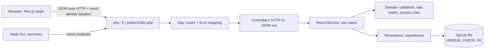
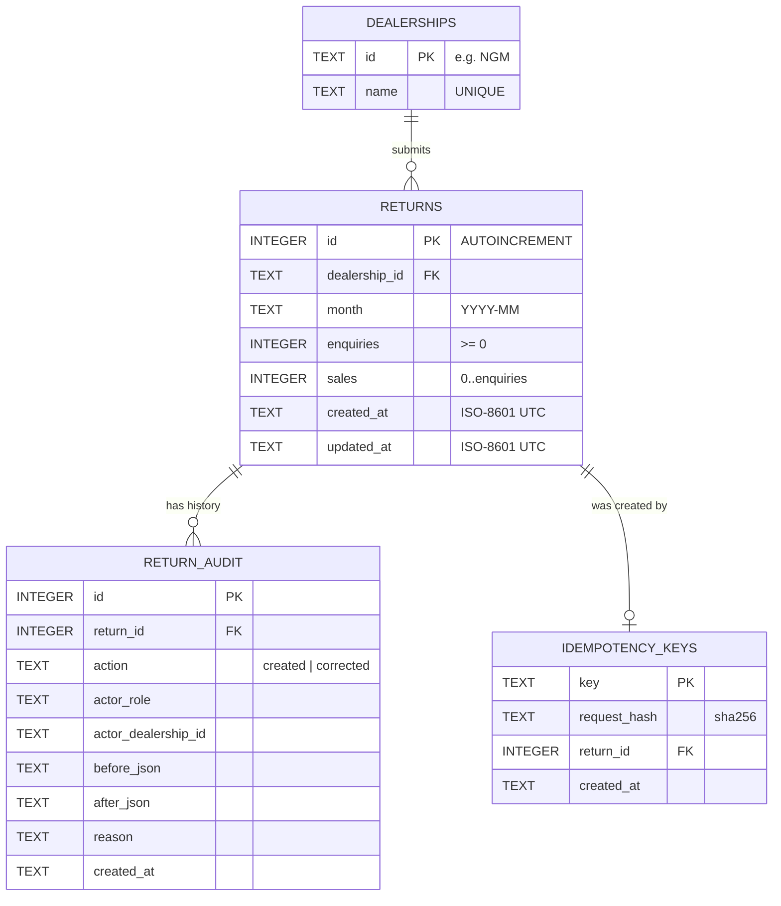
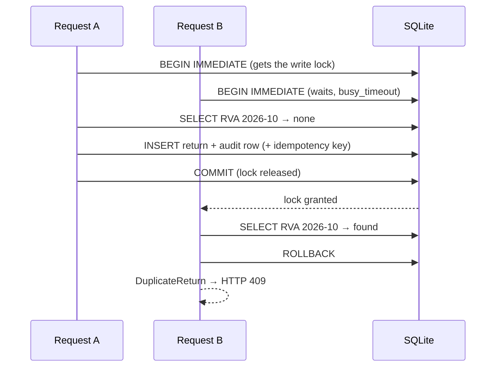
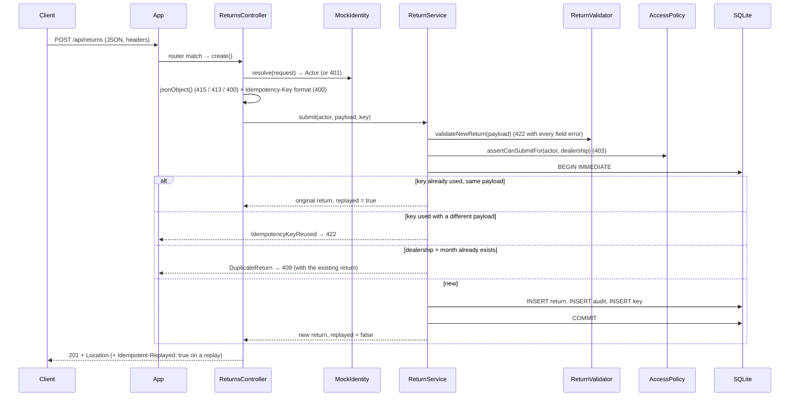

# Debonaire backend rundown: the database, the PHP, and the trade-offs

This is a guided tour of the PHP API and its SQLite database: how each piece is
built, why it is built that way, and where it is weak. Line references point
at the code as committed. Rows and error messages quoted here come from real
runs against the seeded database, not from memory.

**Contents**

1. [The big picture](#1-the-big-picture)
2. [The database](#2-the-database)
3. [How the PHP works](#3-how-the-php-works)
4. [Pluses and minuses](#4-pluses-and-minuses)
5. [Questions you might be asked](#5-questions-you-might-be-asked)
6. [Quick reference](#6-quick-reference)

---

## 1. The big picture



The rule that shapes everything: **the server is the only source of truth.**
The page and the CLI never calculate anything that ends up stored or reported.
They send raw counts, and they receive the rows plus the totals that the PHP
computed from exactly those rows.

| Folder | What lives there | Knows about HTTP? |
|---|---|---|
| [`api/public/`](../api/public/index.php) | The one web-exposed file (front controller) | Yes |
| [`api/src/Http/`](../api/src/Http) | Request, Router, JsonResponse, Cors, MockIdentity, HttpError | Yes |
| [`api/src/Controller/`](../api/src/Controller) | Thin adapters: request → service → JSON | Yes |
| [`api/src/Service/`](../api/src/Service/ReturnService.php) | The use cases: list, get, submit, correct, history | No |
| [`api/src/Domain/`](../api/src/Domain) | Business rules, value objects, domain exceptions | No |
| [`api/src/Persistence/`](../api/src/Persistence) | PDO/SQLite access, seeding | No |
| [`api/database/`](../api/database) | `schema.sql` and the `seed.php` script | No |
| [`api/tests/`](../api/tests) | PHPUnit unit and real-HTTP integration suites | Integration only |

---

## 2. The database

### 2.1 Why SQLite

The brief allowed "SQLite or a simple file store" and asked for an explanation
of how the choice affects concurrency and integrity. SQLite won because:

- **It needs no setup.** An assessor runs `npm run setup` and gets a working
  database file at `api/var/debonaire.sqlite`. There is no server to install.
- **It is a real relational database.** It has transactions, `UNIQUE`,
  `CHECK` and foreign-key constraints. A JSON file store would push every
  integrity rule into PHP and rely on `flock()` for concurrency.
- **The schema ports cleanly.** Everything here maps almost one-to-one onto
  PostgreSQL or MySQL later.

### 2.2 The four tables



The full DDL is in [`api/database/schema.sql`](../api/database/schema.sql).
Table by table:

#### `dealerships`: who can report (F1)

| Column | Type / rule | Why |
|---|---|---|
| `id` | `TEXT PRIMARY KEY` | Short readable codes (`NGM`, `RVA`, `HBC`, `MLV`) that appear in URLs, headers and CLI flags. |
| `name` | `TEXT NOT NULL UNIQUE` | Display name. UNIQUE prevents two "Northgate Motors". |

```text
id   name
---  --------------------
NGM  Northgate Motors
RVA  Riverside Autos
HBC  Harbour Cars
MLV  Meadow Lane Vehicles
```

#### `returns`: one row per dealership per month (F2, F3, F5)

| Column | Type / rule | Why |
|---|---|---|
| `id` | `INTEGER PRIMARY KEY AUTOINCREMENT` | `AUTOINCREMENT` means ids are never reused, even after a delete, so an audit entry can never point at the wrong return. |
| `dealership_id` | `NOT NULL REFERENCES dealerships(id)` | Foreign key: a return must belong to a real dealership, and a dealership with returns cannot be deleted. |
| `month` | `CHECK (month GLOB '[0-9][0-9][0-9][0-9]-[01][0-9]')` | Stored as text `YYYY-MM`. Zero-padded months sort correctly as strings, so `month BETWEEN '2026-06' AND '2026-09'` works with no date maths. |
| `enquiries` | `CHECK (typeof(enquiries) = 'integer' AND enquiries >= 0)` | Whole, non-negative counts only. |
| `sales` | `CHECK (typeof(sales) = 'integer' AND sales >= 0 AND sales <= enquiries)` | **The spec's core rule lives in the database itself:** sales are conversions of the same enquiries. |
| `created_at`, `updated_at` | `TEXT NOT NULL` (ISO-8601 UTC) | SQLite has no date type. ISO-8601 UTC text sorts chronologically and is unambiguous. |
| *(table)* | `UNIQUE (dealership_id, month)` | **The duplicate rule (F5).** Two concurrent requests can never both insert the same dealership and month. |

Real seeded rows:

```text
id  dealership_id  month    enquiries  sales  created_at            updated_at
--  -------------  -------  ---------  -----  --------------------  --------------------
1   NGM            2026-06  412        97     2026-07-03T09:30:00Z  2026-07-03T09:30:00Z
2   NGM            2026-07  389        88     2026-08-03T09:30:00Z  2026-08-03T09:30:00Z
3   NGM            2026-09  450        121    2026-10-03T09:30:00Z  2026-10-03T09:30:00Z
4   NGM            2026-10  431        104    2026-11-03T09:30:00Z  2026-11-03T09:30:00Z
```

There is **no conversion-rate column.** Rates are always derived when read,
so a stored rate can never drift out of step with its counts.

#### `return_audit`: append-only history (F8)

| Column | Why |
|---|---|
| `return_id` | Foreign key to the return it describes. |
| `action` | `CHECK (action IN ('created', 'corrected'))`. |
| `actor_role`, `actor_dealership_id` | Who did it: `dealer` + their dealership, `manager`, or `seed` for sample data. |
| `before_json`, `after_json` | Snapshots of `{"enquiries", "sales"}`. `before_json` is `NULL` for a creation. |
| `reason` | Required by the app for every correction. |
| `created_at` | When the change happened (UTC). |

```text
id  return_id  action   actor_role  before_json  after_json                    reason  created_at
--  ---------  -------  ----------  -----------  ----------------------------  ------  --------------------
1   1          created  seed                     {"enquiries":412,"sales":97}          2026-07-03T09:30:00Z
2   2          created  seed                     {"enquiries":389,"sales":88}          2026-08-03T09:30:00Z
```

The app only ever `INSERT`s here, never `UPDATE`s or `DELETE`s, so a
return's full history can always be replayed.

#### `idempotency_keys`: safe retries (F7)

| Column | Why |
|---|---|
| `key` | `PRIMARY KEY`. The client-generated `Idempotency-Key` (the page sends a UUID). |
| `request_hash` | SHA-256 of *who sent it* plus *the canonical payload*, used to detect a key reused for different data. |
| `return_id` | The return the original request created. A retry gets this return back. |
| `created_at` | When it was first seen. Useful for expiry, which is not implemented yet. |

### 2.3 What the constraints actually catch

These were run directly against a **copy** of the database with the `sqlite3`
CLI. They bypass PHP entirely, which is the "even if the validator had a bug"
scenario:

| Attempt (straight SQL, no PHP) | Result |
|---|---|
| Second `NGM` return for `2026-06` | `UNIQUE constraint failed: returns.dealership_id, returns.month` |
| `enquiries = 5, sales = 9` | `CHECK constraint failed: … sales <= enquiries` |
| `enquiries = -1` | `CHECK constraint failed: … enquiries >= 0` |
| `enquiries = 5.5` | `CHECK constraint failed: typeof(enquiries) = 'integer' …` |
| `enquiries = 'abc'` | `CHECK constraint failed: typeof(enquiries) = 'integer' …` |
| `month = 'Oct 2026'` | `CHECK constraint failed: month GLOB …` |
| Dealership `ZZZ` | `FOREIGN KEY constraint failed` |
| `DELETE` dealership `NGM` (has returns) | `FOREIGN KEY constraint failed` |
| ⚠️ `month = '2026-19'` | **Accepted.** The GLOB only checks the digit shape (`[01][0-9]`), so 13–19 and 00 get through at DB level. |
| ⚠️ `enquiries = '5'` (text) | **Accepted and stored as integer 5.** SQLite's `INTEGER` column affinity converts numeric text *before* the CHECK runs. |

The two ⚠️ rows are caught by PHP: `Month::tryParse` requires `01`–`12`, and
the validator requires true JSON integers. So the system as a whole is
correct, but the database's own safety net has those two holes.
[Section 4](#41-database) explains how to close them.

### 2.4 Indexes

| Index | Created by | Used for |
|---|---|---|
| `sqlite_autoindex_returns_1` on `(dealership_id, month)` | the `UNIQUE` constraint | The duplicate check (`findByDealershipAndMonth`), and any `WHERE dealership_id = ?` filter, because it is the leftmost column. |
| `returns_month_idx` on `(month)` | `schema.sql` | Period filters (`month >= :from AND month <= :to`) when no dealership is given. |
| `return_audit_return_idx` on `(return_id)` | `schema.sql` | Loading one return's history. |
| PK on `idempotency_keys.key` | primary key | The retry lookup. |

### 2.5 How a connection is set up

Every request opens one connection in
[`Database::open`](../api/src/Persistence/Database.php#L36):

| Setting | Value | What it does |
|---|---|---|
| `PDO::ATTR_ERRMODE` | `ERRMODE_EXCEPTION` | Every SQL error throws, so nothing fails silently. |
| `PDO::ATTR_DEFAULT_FETCH_MODE` | `FETCH_ASSOC` | Rows come back as `['column' => value]`. |
| `PDO::ATTR_STRINGIFY_FETCHES` | `false` | Integers come back as PHP `int`, not `"412"`. |
| `PRAGMA foreign_keys` | `ON` | **SQLite has foreign keys off by default.** Without this line the FK constraints above do nothing. |
| `PRAGMA busy_timeout` | `5000` | If another request holds the write lock, wait up to 5 s rather than failing immediately with `SQLITE_BUSY`. |
| `PRAGMA journal_mode` | `WAL` | Write-ahead logging: readers keep reading the last committed state while one writer writes. The setting persists in the file (`PRAGMA journal_mode` reports `wal`). |

All values are bound with prepared statements (`:name` placeholders)
everywhere, so SQL injection is not possible through any input.

### 2.6 Transactions and the duplicate race

SQLite allows **one writer at a time**. Every write path goes through
[`Database::transaction`](../api/src/Persistence/Database.php#L83), which
starts with `BEGIN IMMEDIATE`:

- A plain `BEGIN` (DEFERRED) only takes the write lock at the first write.
  Two requests could both `SELECT` "no return for RVA October" and then both
  try to `INSERT`.
- `BEGIN IMMEDIATE` takes the write lock **before the first read**. While one
  request is inside its transaction, a second one waits (thanks to
  `busy_timeout`) and only proceeds after the first has committed. By then it
  sees the new row.



The `UNIQUE` constraint is still there as a **backstop**. If anything ever
inserted without the check, [`ReturnRepository::insert`](../api/src/Persistence/ReturnRepository.php#L100)
catches the constraint error (SQLSTATE `23000` plus the exact constraint name,
see [`isUniqueViolation`](../api/src/Persistence/ReturnRepository.php#L137))
and turns it into the same friendly 409, never a 500.

**Evidence:** the integration test
`test_concurrent_identical_submissions_store_exactly_one_return` fires 10
identical POSTs at once at a 4-worker server. It expects nine 409s, one 201
and exactly one row, and passed on every repeat run.

### 2.7 Creating the schema ("migrations")

There is no migration tool. [`schema.sql`](../api/database/schema.sql) uses
`CREATE TABLE IF NOT EXISTS` / `CREATE INDEX IF NOT EXISTS` throughout, so it
is safe to run any number of times.
[`App::fromEnvironment`](../api/src/App.php#L52) runs it on every request
(`Database::migrate`). That keeps a fresh checkout working with no extra step.
The cost is small but real; see [section 4](#41-database).

### 2.8 Seed data

[`Seeder`](../api/src/Persistence/Seeder.php) loads four dealerships and ten
returns, chosen to hit every reporting edge case in the brief:

| Dealership | Jun | Jul | Aug | Sep | Oct | Purpose |
|---|---|---|---|---|---|---|
| Northgate Motors (NGM) | 412 / 97 | 389 / 88 | – | 450 / 121 | 431 / 104 | High volume |
| Riverside Autos (RVA) | 128 / 31 | 140 / 29 | – | 117 / 22 | *free* | Mid volume, with a free slot for a demo submission |
| Harbour Cars (HBC) | 14 / 3 | **0 / 0** | – | 9 / 2 | – | Low volume, and the **zero-enquiry** return |
| Meadow Lane Vehicles (MLV) | – | – | – | – | – | A dealership with no returns at all |

**August 2026 is empty for everyone** (the "month with no returns" case).

- It is **idempotent**: `INSERT OR IGNORE` plus `rowCount()` means re-running
  it adds nothing that already exists.
- It writes `created` audit rows with `actor_role = 'seed'`, so seeded returns
  have a history too.
- Timestamps are deterministic (09:30 UTC on the 3rd of the following month).
  That is why the duplicate message always says "submitted 3 Nov 2026".
- `php database/seed.php --fresh` deletes the file (and its `-wal`/`-shm`
  companions) and starts again. `npm run seed:fresh` wraps it.

### 2.9 What a request actually writes

**Submitting a return** (`POST /api/returns`, with an `Idempotency-Key`),
all in one transaction:

```text
returns            → id 11 | RVA | 2026-10 | 131 | 27 | 2026-11-02T11:40:00Z | 2026-11-02T11:40:00Z
return_audit       → return 11 | created | manager | before NULL | after {"enquiries":131,"sales":27}
idempotency_keys   → 6f1c…3c21 | sha256(actor + payload) | return 11
```

(The id, timestamp and key are illustrative.)

**Correcting a return** (`PUT /api/returns/8`, manager only), also in one transaction:

```text
returns            → UPDATE id 8: enquiries 14 → 16, sales 3 → 4, updated_at = now
return_audit       → return 8 | corrected | manager | before {"enquiries":14,"sales":3}
                     | after {"enquiries":16,"sales":4} | reason "Two web enquiries were missed…"
```

Because the update and its audit row share a transaction, **a change without
a history entry is impossible.** Either both commit or neither does.

### 2.10 Time zones

- Stored timestamps are **UTC** (`…Z`).
- "Which month is it now?" is answered in **Europe/London**
  ([`Month::current`](../api/src/Domain/Month.php#L53)). At 23:30 UTC on 31 May
  it is already June in the UK (BST), and a unit test pins exactly that case.
- The clock is **injected** (`Clock` interface, `SystemClock`, `FixedClock`),
  so tests freeze time instead of depending on today's date.

---

## 3. How the PHP works

### 3.1 The life of one request

PHP is "share-nothing": every request starts from scratch and nothing stays
in memory between requests. In order:

1. **`php -S 127.0.0.1:8000 public/index.php`** passes *every* path to
   [`public/index.php`](../api/public/index.php) as a router script, including
   ones that look like files.
2. `index.php` loads Composer's autoloader and makes one call:
   `App::fromEnvironment()->handle(Request::fromGlobals())->send()`.
3. **[`Request::fromGlobals`](../api/src/Http/Request.php#L34)** turns
   `$_SERVER`, `$_GET` and `php://input` into an immutable `Request`
   (method, path, query, lower-cased headers, raw body). Nothing after this
   touches superglobals.
4. **[`App::fromEnvironment`](../api/src/App.php#L52)** reads the env vars,
   opens the database (PRAGMAs), runs the idempotent schema, picks the clock,
   then **[`App::build`](../api/src/App.php#L76)** wires every object by hand
   and registers the routes.
5. **[`App::handle`](../api/src/App.php#L111)**: `OPTIONS` (a CORS preflight)
   is answered straight away with 204. Otherwise the router dispatches, and
   **any** throwable is caught and turned into JSON. This method never throws.
6. **[`Router::dispatch`](../api/src/Http/Router.php#L32)** matches method and
   path. `{id}` only matches `[1-9][0-9]{0,17}`, so `/api/returns/abc` is a
   404 that never reaches a query. A known path with the wrong method is a 405
   with an `Allow` header.
7. The **controller** resolves the caller with **`MockIdentity`**, reads the
   body or query, and calls **`ReturnService`**.
8. The **service** follows the same rhythm every time: **validate →
   authorise → do the work** (inside a transaction if it writes).
9. The controller wraps the result in a **`JsonResponse`**, **`Cors::apply`**
   adds headers for allowed origins, and **`send()`** writes the status,
   headers and JSON.

### 3.2 `POST /api/returns`, end to end



### 3.3 The layers and who is allowed to know what

| Layer | Responsibility | Must not |
|---|---|---|
| **Http** | Parse requests, route, serialise JSON, CORS, mock identity | Contain business rules |
| **Controller** | Translate HTTP ↔ service calls (headers, status codes) | Check roles or validate fields itself |
| **Service** | Orchestrate a use case: validate, authorise, run the transaction | Know about HTTP status codes |
| **Domain** | Rules, value objects, maths, domain exceptions | Touch the database or HTTP |
| **Persistence** | SQL and row ↔ object mapping | Decide business outcomes (it only reports facts such as "this would duplicate") |

The payoff is in the tests. The domain is unit-tested with no database
(`InMemoryDealerships`, `FixedClock`), and the HTTP behaviour is tested
through a real server.

### 3.4 Tour of the key classes

#### `Request`: [`Http/Request.php`](../api/src/Http/Request.php)
- `jsonObject()` ([line 69](../api/src/Http/Request.php#L69)) is the only way
  to read a body:
  - `Content-Type` must be `application/json`, else **415**.
  - The body must be ≤ 16 KB, else **413**.
  - The JSON must parse (depth ≤ 8), else **400 `invalid_json`**.
  - It must be a JSON **object**, not a list.
- **The stdClass trick:** it decodes with `json_decode($body, false)` first,
  because associative decoding turns both `{"a":1}` and `[1]` into PHP
  arrays. Decoding to objects lets it reject `[1,2,3]` and then convert with
  `get_object_vars()`.

#### `Router`: [`Http/Router.php`](../api/src/Http/Router.php)
- Around 60 lines. `add('GET', '/api/returns/{id}', $handler)` compiles the
  path to a regex.
- It collects the methods registered for a matching path so it can answer
  **405 + `Allow`** instead of a misleading 404.

#### `MockIdentity`: [`Http/MockIdentity.php`](../api/src/Http/MockIdentity.php)
- Reads `X-Debonaire-Role` (`dealer` | `manager`) and
  `X-Debonaire-Dealership`.
- **It fails closed:** missing or unknown headers give **401**, never a
  default role. A dealer must name a dealership that exists.
- Every mock-auth touchpoint is commented `MOCK AUTH (F9)` and says what
  production would do instead (verify a session or SSO-issued token).

#### `ReturnsController`: [`Controller/ReturnsController.php`](../api/src/Controller/ReturnsController.php)
- Kept deliberately thin.
- It owns only HTTP details: the `Location` header on 201, the
  `Idempotent-Replayed: true` header on a replay, and the Idempotency-Key
  format (`^[A-Za-z0-9_-]{8,128}$`, else 400). That rule stops junk ending up
  in the database.

#### `ReturnService`: [`Service/ReturnService.php`](../api/src/Service/ReturnService.php)
- **[`list`](../api/src/Service/ReturnService.php#L65):** validate the filter
  → apply the access scope → `search()` → `totals()` computed from **those
  exact rows**.
- **[`submit`](../api/src/Service/ReturnService.php#L106):** shown in the
  diagram above.
- **[`correct`](../api/src/Service/ReturnService.php#L178):**
  1. Manager-only check first.
  2. Validate counts and reason.
  3. In the transaction: load the return (404 if missing), then reject a
     "correction" that changes nothing (422, so the audit trail isn't
     cluttered).
  4. `UPDATE` plus the audit row.
- **[`history`](../api/src/Service/ReturnService.php#L220):** manager-only →
  404 if missing → audit rows, oldest first.

#### `ReturnValidator`: [`Domain/ReturnValidator.php`](../api/src/Domain/ReturnValidator.php)

It checks **every field and returns all the problems together**, so the user
can fix the whole form in one go:

| Rule | Message (exact) |
|---|---|
| Unknown field (e.g. `totals`) | `Unexpected field "totals". Only dealershipId, month, enquiries, sales are accepted; totals and rates are always calculated by the server.` |
| Missing / null dealership | `Dealership is required.` |
| Non-string dealership | `Dealership must be given as its identifier, e.g. "NGM".` |
| Unknown dealership | `Unknown dealership "ZZZ".` |
| Bad month format | `Month must be in YYYY-MM format, e.g. 2026-03.` |
| Future month | `Month cannot be in the future. The latest month you can report is 2026-11.` |
| Count not a JSON integer (`"5"`, `5.5`, `5.0`, `true`) | `Enquiries must be a whole number.` |
| Negative count | `Enquiries cannot be negative.` |
| Over 1,000,000 | `Enquiries cannot be more than 1,000,000.` |
| Sales > enquiries | `Sales (11) cannot be more than enquiries (10), because sales are conversions of those enquiries.` |

Notes:
- **`5.0` is rejected on purpose.** `json_decode` makes it a float, which
  shows the client isn't sending whole numbers.
- **The sales > enquiries rule only runs once both counts are individually
  valid.** A bad enquiries value doesn't also produce a confusing second
  error on sales.
- **Corrections have their own rules.** They accept only `enquiries`, `sales`
  and `reason`. Sending `dealershipId` or `month` gets a specific "cannot be
  changed by a correction" message.
- **Filters** (`from`, `to`, `dealershipId`): an empty string means "not
  set", `from > to` is rejected, and future months are allowed (they simply
  return nothing).

#### `Month`: [`Domain/Month.php`](../api/src/Domain/Month.php)
- The pattern is `/^(\d{4})-(0[1-9]|1[0-2])\z/`.
- It uses **`\z`, not `$`**, because in PCRE `$` also matches before a
  trailing newline, which would let `"2026-03\n"` through. A unit test covers
  this case.

#### `ReportCalculator`: [`Domain/ReportCalculator.php`](../api/src/Domain/ReportCalculator.php)

The overall rate is **pooled**: total sales ÷ total enquiries. It is not an
average of each dealership's rate. Averaging 10% (400 enquiries) and 100%
(4 enquiries) would claim 55%. The pooled figure is 44 ÷ 404 = **10.89%**.

Rounding is **half-up to 0.01% using integers only**
([line 29](../api/src/Domain/ReportCalculator.php#L29)):

```text
basisPoints = intdiv(sales × 10000 × 2 + enquiries, enquiries × 2)     // null if enquiries = 0
rate        = basisPoints / 100
```

| Sales / enquiries | Exact % | Result | Note |
|---|---|---|---|
| 497 / 2090 | 23.7799… | **23.78** | All seed data |
| 1 / 32 | 3.125 | **3.13** | An exact half rounds up |
| 201 / 20000 | 1.005 | **1.01** | JS `(1.005).toFixed(2)` gives `"1.00"`; floats get this wrong |
| 0 / 0 | undefined | **null → "N/A"** | Not 0%: there was nothing to convert |

The TypeScript twin (`shared/src/reporting.ts`) uses `BigInt` for the same
formula. **Both test suites read the same 16 vectors from
`fixtures/conversion-cases.json`**, so PHP and JavaScript provably agree.

#### `AccessPolicy`: [`Domain/AccessPolicy.php`](../api/src/Domain/AccessPolicy.php)

All "who may do what" rules live in one class:

| Action | Dealer | Manager |
|---|---|---|
| List dealerships | own only | all |
| List returns | **forced** to own (asking for another gives 403) | all, filterable |
| View one return | own only | any |
| Submit | own dealership only | any (e.g. keying in a paper return) |
| Correct | ✗ | ✓ |
| View history | ✗ | ✓ |

[`scopeFilter`](../api/src/Domain/AccessPolicy.php#L58) **narrows** a dealer's
filter when they don't name a dealership, so leaving the filter out can't
leak data. It **refuses** an explicit request for someone else's dealership,
so a client bug shows up as an error rather than as quietly wrong figures.

#### `JsonResponse`: [`Http/JsonResponse.php`](../api/src/Http/JsonResponse.php)
- **One error envelope everywhere:**
  `{"error": {"code", "message", "fields"?, "existing"?}}`.
- `send()` adds `Cache-Control: no-store` and `X-Content-Type-Options: nosniff`.
- It encodes with `JSON_PRESERVE_ZERO_FRACTION`, so 25% goes out as `25.0`,
  not `25`, and `conversionRate` is always a decimal or `null`. The first
  PHP test run caught this.

#### `Cors`: [`Http/Cors.php`](../api/src/Http/Cors.php)
- An **allowlist** of origins (`DEBONAIRE_ALLOWED_ORIGINS`). Any other origin
  gets no `Access-Control-Allow-Origin`.
- A preflight returns 204 with the allowed methods and headers
  (`Content-Type`, `Idempotency-Key`, the two identity headers).
- `Location` and `Idempotent-Replayed` are exposed to the browser.

#### `App`: [`App.php`](../api/src/App.php)

The composition root. Objects are wired by hand because, at this size, a DI
container would add indirection without adding clarity.
[`errorResponse`](../api/src/App.php#L129) is **the one place** where
failures become status codes (next section).

### 3.5 Error handling model

The domain throws **HTTP-agnostic exceptions**. Only `App` knows status codes:

| Thrown | Status | `code` | Extra |
|---|---|---|---|
| `HttpError` (bad JSON, wrong content type, too large, missing identity, unknown route, wrong method) | 400 / 401 / 404 / 405 / 413 / 415 | as thrown | `Allow` header on 405 |
| `ValidationFailed` | 422 | `validation_failed` | `fields` with one message per field |
| `IdempotencyKeyReused` | 422 | `idempotency_key_reused` | – |
| `AccessDenied` | 403 | `forbidden` | – |
| `ReturnNotFound` | 404 | `not_found` | – |
| `DuplicateReturn` | 409 | `duplicate_return` | `existing`: the return already stored |
| anything else | 500 | `internal_error` | Full detail goes to the server log only. The client never sees a stack trace or SQL |

### 3.6 Idempotency in detail

| Situation | What happens |
|---|---|
| No key sent | Normal behaviour: 201 or 409 |
| New key | Insert the return and store `key → (hash, return_id)` in the same transaction |
| **Same key, same payload, same actor** (a retry after a lost response) | No insert. **Replays the original 201** with `Idempotent-Replayed: true` |
| Same key, different payload or actor | **422 `idempotency_key_reused`**: a client bug, so it is not silently replayed |
| New key, but that dealership/month already exists | 409 duplicate: a genuinely different submission |

The page creates a UUID per submission attempt and **reuses it while the
user retries the same data**. Editing the form starts a new attempt with a
new key. The end-to-end test drops a real response mid-flight, then checks
that the retry shows success and that exactly one row exists.

### 3.7 Configuration

| Env var | Default | Purpose |
|---|---|---|
| `DEBONAIRE_DB` | `api/var/debonaire.sqlite` | Database file (tests and e2e use their own) |
| `DEBONAIRE_ALLOWED_ORIGINS` | `http://localhost:3000,http://127.0.0.1:3000` | CORS allowlist |
| `DEBONAIRE_FIXED_NOW` | *(unset: real clock)* | Freeze "now" for tests, e.g. `2026-11-15T12:00:00Z` |
| `PHP_CLI_SERVER_WORKERS` | `4` in our scripts | Lets the dev server handle requests in parallel (needed for the concurrency tests) |

### 3.8 How the PHP is tested

| Suite | Count | How |
|---|---|---|
| Unit (`api/tests/Unit`) | 107 | Pure PHP, no database. Every validator rule, month parsing and UK time, the 16 shared rate vectors, the access matrix. |
| Integration (`api/tests/Integration`) | 62 | [`ApiTestCase`](../api/tests/Integration/ApiTestCase.php) starts `php -S` with the real front controller on a **free port**, a **temporary SQLite file**, a **frozen clock** and 4 workers. Before **each test** it wipes and reseeds the data. Calls go over real HTTP with curl (`curl_multi` for concurrency). On teardown it kills the server and its worker processes. |

Nothing in the integration suite is mocked. It exercises routing, JSON
parsing, CORS, SQLite constraints and real transactions.

### 3.9 Conventions you'll see in every file

- `declare(strict_types=1)`, `final` classes, `readonly` properties,
  constructor promotion, a backed `enum` for `Role`, and first-class
  callables (`$controller->list(...)`) for routes.
- A file docblock naming the **feature IDs** (F1–F14) and **spec section**.
  Those IDs also appear in test names and commit messages, so a requirement
  can be traced from spec to code to test to commit.
- **"Why" comments at the point a rule is enforced** (e.g. *"Sales are
  conversions of the same enquiries, so they can never exceed them"*), never
  comments that restate the code.

---

## 4. Pluses and minuses

### 4.1 Database

**Pluses**

- ✅ **Integrity is enforced twice**, in PHP and in the schema. The probes in
  §2.3 show the database alone rejects duplicates, sales > enquiries,
  negatives, non-integers, bad months and orphan rows.
- ✅ **The duplicate race is genuinely solved** (`BEGIN IMMEDIATE` plus
  `UNIQUE`). A test proves it with 10 parallel requests.
- ✅ **No stored derived data.** Rates are computed on read, so they can't go
  stale.
- ✅ **An audit trail that can't drift from the data**, because each change
  and its audit row share a transaction.
- ✅ **No setup**, deterministic seed data, and a one-command reset.
- ✅ **A portable schema.** Moving to PostgreSQL is mostly a change of types
  and syntax.

**Minuses, and what I'd do about them**

| Weakness | Impact | Fix |
|---|---|---|
| **One writer at a time; the file must be local to a single API host** | Can't scale horizontally. Heavy write bursts queue up | Move to PostgreSQL when there is more than one API instance or real write volume |
| **The month CHECK accepts `2026-00` and `2026-13`–`2026-19`** | Only PHP blocks impossible months | `CHECK (month GLOB '[0-9][0-9][0-9][0-9]-[0-9][0-9]' AND CAST(substr(month, 6, 2) AS INTEGER) BETWEEN 1 AND 12)` |
| **Column affinity turns text `'5'` into integer 5** | The DB's `typeof` check can't stop numeric strings; only PHP does | Use SQLite `STRICT` tables (3.37+), which reject wrong types outright |
| **Schema runs on every request** | A few cheap no-op statements per request | Versioned migrations (e.g. Phinx or Doctrine Migrations) run once per deploy |
| **No migration history** | Adding a column means hand-written `ALTER`s | As above |
| **A busy lock beyond 5 s becomes a 500** | Under extreme contention the client sees "something went wrong" | Catch `SQLITE_BUSY` and return **503 with `Retry-After`** |
| **Idempotency keys never expire** | The table grows forever | Expire after ~24 h (scheduled delete), and scope keys per actor |
| **The audit log is app-enforced append-only** | Anyone with DB access could edit history | `BEFORE UPDATE/DELETE` triggers that `RAISE(ABORT)`, a hash chain, or shipping the audit to write-once storage |
| **Timestamps stored as text** | Fine in SQLite (no native date type), but easy to misuse | `timestamptz` in PostgreSQL |
| **No pagination or archiving** | Years of data would make the list slow | Paginate `GET /api/returns`, archive old months |

### 4.2 PHP design

**Pluses**

- ✅ **Readable top to bottom.** No framework magic: 40 small files in
  `api/src` (many of them value objects, interfaces or one-line exception
  types), each with one job, and an assessor can follow a request through
  every line.
- ✅ **Thin controllers and a clear rhythm in the service** (validate →
  authorise → transact), with all access rules in `AccessPolicy` and all
  status codes in `App::errorResponse`.
- ✅ **The domain doesn't know about HTTP or SQL**, so it unit-tests in
  milliseconds.
- ✅ **Correct maths.** Integer half-up rounding, pooled rates, `N/A` for zero
  enquiries, and fixture-locked parity with JavaScript.
- ✅ **Fails closed and leaks nothing.** No default identity, generic 500s,
  prepared statements everywhere, a strict body parser, and an allowlist for
  CORS.
- ✅ **Helpful errors.** Every field error is returned at once, and the 409
  names the dealership, the month and the original submission date.
- ✅ **Tested through real HTTP**, including concurrency and idempotency, with
  a frozen clock so the tests won't rot as real time passes.

**Minuses**

| Weakness | Impact | Fix |
|---|---|---|
| **Hand-rolled router and request objects** | Fine at this size, but no middleware pipeline, request IDs or rate limiting | Slim or Laravel once the API grows, or PSR-7/PSR-15 components |
| **Authentication is mocked** | Anyone can send `X-Debonaire-Role: manager` | OIDC/SSO. Build the `Actor` from verified token claims; `AccessPolicy` stays as it is |
| **The built-in server is dev-only** | Not hardened, not tuned for production | PHP-FPM behind nginx (or similar) |
| **The object graph is rebuilt per request** | Negligible here (PHP is share-nothing by design) | OPcache in production; nothing else needed at this scale |
| **Strictness can feel unfriendly** | `"5"` is rejected; unknown fields are rejected, so a newer client sending an extra field would break | A deliberate trade-off: correctness over leniency. Version the API if fields are added |
| **Totals are computed in PHP from the fetched rows** | Guarantees table and totals match, but loads every row | Over a threshold, compute `SUM()` in SQL within the same transaction snapshot, plus pagination |
| **Logging is plain `error_log`** | No structure or correlation | Structured JSON logs with a request ID, plus an error tracker |
| **No API schema document** | Clients rely on the README | OpenAPI spec, generated or hand-written, and contract tests |

### 4.3 Deliberately out of scope

Out of scope, per the brief: real authentication, deployment and multi-tenant
hosting. Not built: a correction-request workflow for dealers, CSV export,
and soft deletes.

---

## 5. Questions you might be asked

**Why no framework?**
The brief values clear code and reasoning over infrastructure. Plain PHP
keeps every rule visible. The structure (controllers, a service, domain,
repositories) mirrors what a framework would give, so moving to Slim or
Laravel later is mechanical.

**How do you stop duplicates when two requests arrive together?**
The duplicate check and the insert run in a `BEGIN IMMEDIATE` transaction,
which takes SQLite's single write lock first, so the second request only
checks after the first has committed. A `UNIQUE(dealership_id, month)`
constraint is the backstop, and its violation is mapped to the same 409. It
is tested with 10 parallel POSTs.

**A submission succeeds but the response is lost. What then?**
The page sends an `Idempotency-Key` and reuses it on retry. The server finds
the key, checks the payload hash matches, and replays the original 201. The
user sees success, not a misleading "duplicate", and no second row exists.
The e2e test drops a real response to prove it.

**What if the browser sends its own totals or skips validation?**
Every rule is enforced in PHP. Unknown fields such as `totals` are rejected
with 422, the database constraints repeat the critical rules, and totals are
only ever computed by the server. The e2e suite calls the API straight from
the page with bad data to prove it.

**How do the table, the totals and the CLI stay consistent?**
The server computes totals from exactly the rows it returns for the same
filter. The page displays those totals. The CLI recomputes them from the rows
and exits with code 3 if they differ. The rate formula is shared and
fixture-tested in both languages, and formatting comes from one shared module.

**Why integer arithmetic for the rate?**
Floats round some values differently in PHP and JavaScript. 1.005% becomes
"1.00" with `toFixed`. Integer basis points with half-up rounding give the
identical answer everywhere.

**Why "N/A" rather than 0% for zero enquiries?**
0% would mean "enquiries came in and none converted". With no enquiries the
rate is undefined, and saying so is more honest.

**How would you add real authentication?**
Replace `MockIdentity` with middleware that verifies a session or SSO token
and builds the `Actor` from its claims (role, dealership). `AccessPolicy` and
everything below it stay the same. Add CSRF protection if using cookies.

**What breaks first under load?**
SQLite's single writer: bursts of submissions queue on the lock and, beyond
5 s, surface as 500s. Next comes listing every row without pagination. Both
fixes are well understood: PostgreSQL, a 503 with `Retry-After`, and
pagination.

**How would you move to PostgreSQL?**
Swap the PDO DSN. Translate the schema (`SERIAL`/`IDENTITY`, `timestamptz`,
proper `CHECK`s). Replace `BEGIN IMMEDIATE` with `SERIALIZABLE`, or rely on
`INSERT … ON CONFLICT` plus the unique index. Introduce versioned migrations.
The repositories' SQL is otherwise standard.

---

## 6. Quick reference

```bash
npm run setup          # composer + npm install, create and seed the DB
npm run dev:api        # PHP API only, http://127.0.0.1:8000
npm run seed:fresh     # reset to the seed data
npm run test:php       # PHPUnit: 107 unit + 62 integration
```

```bash
curl -s -H 'X-Debonaire-Role: manager' 'http://127.0.0.1:8000/api/returns?from=2026-07&to=2026-07'
curl -s -X POST http://127.0.0.1:8000/api/returns \
  -H 'Content-Type: application/json' -H 'X-Debonaire-Role: dealer' -H 'X-Debonaire-Dealership: RVA' \
  -H 'Idempotency-Key: 6f1c0d1e-9a43-4b8e-9d7e-2a6f5e4b3c21' \
  -d '{"dealershipId":"RVA","month":"2026-10","enquiries":131,"sales":27}'
```

| Endpoint | Who | Success | Typical errors |
|---|---|---|---|
| `GET /api/health` | anyone | 200 | – |
| `GET /api/dealerships` | any identity | 200 | 401 |
| `GET /api/returns?from&to&dealershipId` | any identity (dealers scoped) | 200 rows + totals + filter | 401, 403, 422 |
| `GET /api/returns/{id}` | own (dealer) / any (manager) | 200 | 401, 403, 404 |
| `POST /api/returns` | own (dealer) / any (manager) | 201 + `Location` | 400, 401, 403, 409, 413, 415, 422 |
| `PUT /api/returns/{id}` | manager | 200 | 401, 403, 404, 422 |
| `GET /api/returns/{id}/audit` | manager | 200 | 401, 403, 404 |
