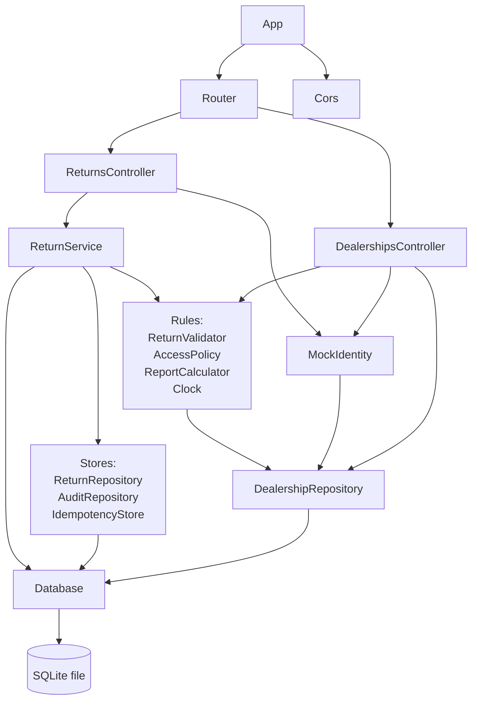
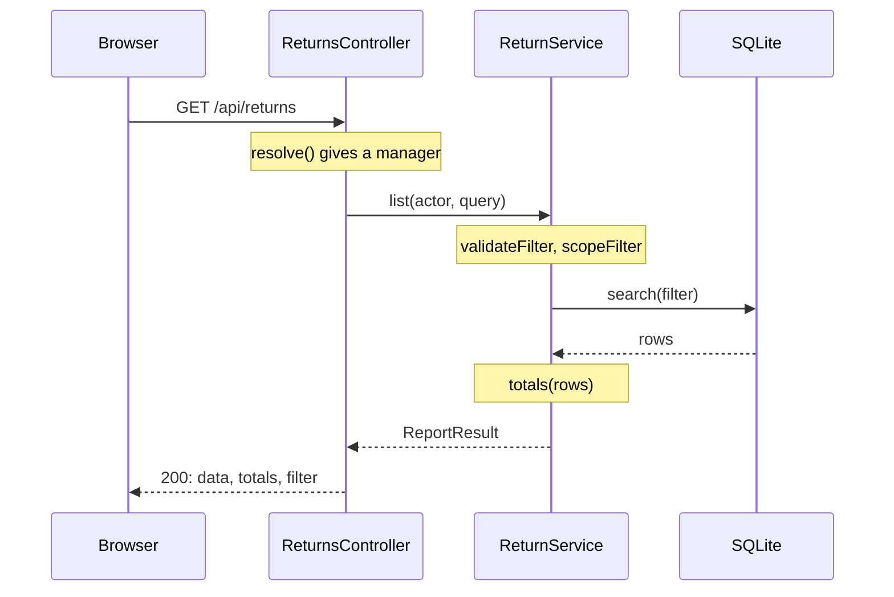
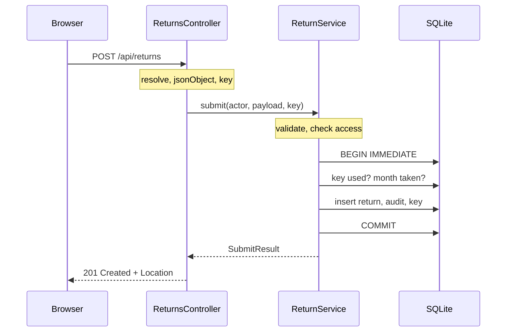
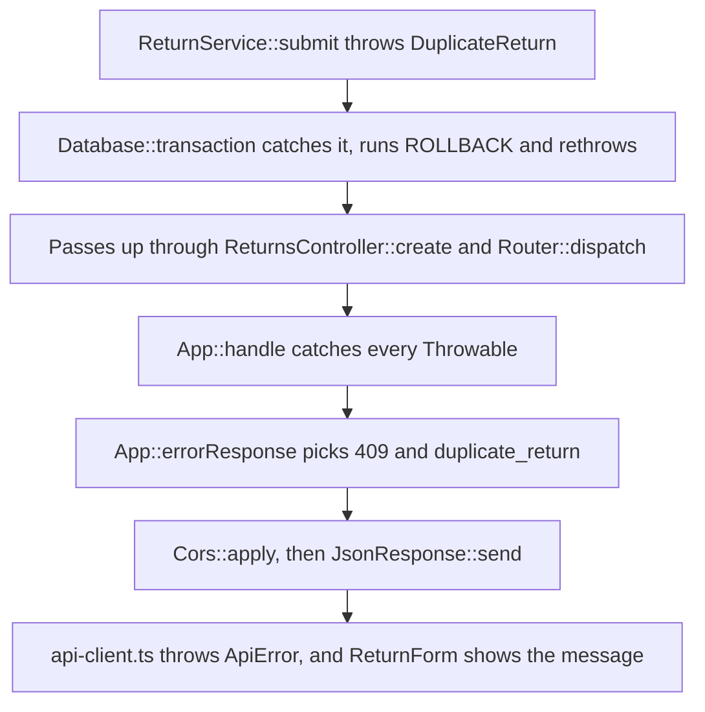

# Reading the Debonaire PHP code

*A guide to the API's functions and classes for JavaScript developers, from the browser's fetch call to the database and back*

## About this guide

This guide walks through the PHP code behind the Debonaire dealership app. It
is written for someone who knows JavaScript but has not worked with PHP. It
starts with the parts of PHP that look strange to a JavaScript developer. Then
it follows real requests from the TypeScript code that sends them, through
every PHP function they touch, down to the database and back to the browser.

It has a companion, *How the Debonaire backend works*
([docs/backend-rundown.pdf](backend-rundown.pdf)). That guide explains the
design: why SQLite was chosen, how the tables are built, why the code is split
into layers, and the strengths and weaknesses of the approach. This guide is
about the code itself: which function calls which, what each class is for, and
what the important lines do. You don't need to read the other guide first.

The sections are:

1. **PHP for JavaScript developers.** The language, explained in terms of
   JavaScript and TypeScript.
2. **A map of the code.** Every file, and how the objects connect.
3. **Where the JavaScript calls the PHP.** Every place the web page and the
   command-line tool send a request, and which PHP function answers it.
4. **The entry point.** The single file every request starts in, and the four
   steps it runs.
5. **Following requests through the code.** Four journeys, step by step.
6. **Class reference.** Every class and method, with who calls it.
7. **Patterns you'll see again and again.**
8. **Try it yourself.** Small experiments that make the code easier to follow.
9. **Glossary.**

Names of functions and files link to the exact line in the repository. In the
PDF version, where links can't open the code, a small grey label such as
<code>api/src/App.php:111</code> gives the file and line instead (inside
tables, just the line). Paths start at the repository root. Every line number
was checked against the code at the time of writing.

---

## 1. PHP for JavaScript developers

### 1.1 PHP starts from scratch for every request

The biggest difference between PHP and Node.js is not the syntax but how a
server runs. A Node.js server is a program that starts once, sets itself up,
and then waits for requests in a loop. Anything it creates at start-up, such
as a database connection, stays in memory and is shared by every request that
follows.

PHP works the other way round. For every request, the web server runs the PHP
script from the top. The script builds whatever it needs, sends one response,
and then everything it created is thrown away. No variables, objects or open
connections survive from one request to the next. This is called the
**share-nothing** model.

For this project, that means the whole start-up sequence runs again for every
single request: opening the database, checking that the tables exist, and
creating about fifteen objects. That sounds wasteful, but each step takes a
fraction of a millisecond. In return it gives a guarantee Node can't: one
request can never see leftovers from another.

In development the API runs on PHP's built-in web server, which
`npm run dev:api` starts:

```bash
PHP_CLI_SERVER_WORKERS=4 php -S 127.0.0.1:8000 public/index.php
```

`-S` starts a server on that address. Naming `public/index.php` makes it the
**router script**, so every request runs that one file, whatever its URL.
`PHP_CLI_SERVER_WORKERS=4` starts four worker processes, so four requests can
be handled at the same time. Each one still starts fresh.

If it helps, picture every incoming request launching `node index.js` as a
brand-new process, which handles that one request and then exits.

### 1.2 The syntax side by side

Most PHP syntax has a direct JavaScript equivalent. These are the differences
you'll meet in this project.

| PHP | JavaScript | Notes |
|---|---|---|
| `$name = 'Ada';` | `let name = 'Ada';` | Every variable starts with `$`. There is no `let` or `const`. |
| `'Hello ' . $name` | `'Hello ' + name` | A dot joins strings. `+` only adds numbers. |
| `"Hello $name"` | `` `Hello ${name}` `` | Double quotes fill in variables. Single quotes don't. |
| `$order->total` | `order.total` | `->` reads a property or calls a method on an object. |
| `$this->db` | `this.db` | `$this` is the current object, as in JavaScript. |
| `Month::tryParse($s)` | `Month.tryParse(s)` | `::` reaches static methods and constants. |
| `self::MAX_COUNT` | `ReturnValidator.MAX_COUNT` | `self` means "this class". |
| `['NGM', 'RVA']` | `['NGM', 'RVA']` | A list. |
| `['id' => 7, 'name' => 'NGM']` | `{ id: 7, name: 'NGM' }` | Also an array in PHP (see 1.3). |
| `$row['name']` | `row.name` | Array keys always use square brackets. |
| `$a ?? $b` | `a ?? b` | Same meaning: use `$b` when `$a` is null or missing. |
| `$a ?: $b` | `a \|\| b` | Use `$b` when `$a` is "falsy" (empty string, 0, false, null). |
| `$from?->toString()` | `from?.toString()` | Skip the call when the value is null. |
| `===` and `!==` | `===` and `!==` | Same strict comparisons. |
| `$a <=> $b` | `a < b ? -1 : a > b ? 1 : 0` | The "spaceship" operator, made for sorting. |
| `fn ($r) => $r->id` | `(r) => r.id` | A one-expression arrow function. |
| `function () use ($id) { … }` | `() => { … }` | A full anonymous function must list the outer variables it uses (see 1.7). |
| `match (true) { … }` | an `if … else if` chain that returns a value | See 4.6. |
| `echo $text;` | `res.write(text)` | Writes to the response body. |
| `/** … */` above a function | JSDoc | "Docblocks" describe parameters and types. |

### 1.3 Arrays do the job of both arrays and objects

PHP has one structure, the **array**, that covers both a JavaScript array and
a plain JavaScript object. Strictly speaking it is an ordered map: the keys
are whole numbers or strings, and the order you add them in is kept.

```php
$list = ['NGM', 'RVA'];                           // keys 0 and 1
$row  = ['id' => 7, 'dealership_id' => 'NGM'];    // keys 'id' and 'dealership_id'
```

Four consequences show up in this project:

1. **Database rows come back as arrays.** Where a JavaScript database
   library would give you `row.enquiries`, PHP gives you `$row['enquiries']`.
2. **Arrays are copied when you pass them to a function, not shared.** In
   JavaScript, if a function pushes onto an array you passed it, you see the
   change. In PHP the function works on its own copy. PHP copies lazily, only
   when one side actually changes it, so this is cheap. To let a function
   change the caller's array, you put `&` before the parameter, which is called
   **passing by reference**. The validator does this with `array &$errors`, so
   each small check can add its message to one shared list (see 6.4). Objects
   are different: they behave like JavaScript objects, and every holder sees
   the same one.
3. **`+` merges arrays, and the keys on the left win.** `$new + $old` is the
   same as `{ ...old, ...new }` in JavaScript. `JsonResponse::withHeaders`
   uses this to add headers.
4. **`array_filter` keeps the original keys.** Filtering `[0 => 'a', 1 => 'b',
   2 => 'c']` down to `'a'` and `'c'` leaves keys 0 and 2, with a gap. JSON
   would then encode it as an object instead of a list, so the code wraps
   filters in `array_values()`, which renumbers from zero.
   `AccessPolicy::visibleDealerships` does exactly this.

### 1.4 Classes look a lot like TypeScript classes

Here is the `Actor` class, cut down a little, with its TypeScript equivalent.

```php
final class Actor
{
    private function __construct(
        public readonly Role $role,
        public readonly ?string $dealershipId,
    ) {
    }

    public static function manager(): self
    {
        return new self(Role::Manager, null);
    }

    public function isManager(): bool
    {
        return $this->role === Role::Manager;
    }
}
```

```ts
class Actor {
  private constructor(
    public readonly role: Role,
    public readonly dealershipId: string | null,
  ) {}

  static manager(): Actor {
    return new Actor(Role.Manager, null);
  }

  isManager(): boolean {
    return this.role === Role.Manager;
  }
}
```

The differences worth knowing:

- **`__construct` is the constructor.** Marking a constructor parameter
  `public` or `private` turns it into a property automatically. PHP calls this
  **constructor property promotion**, and it is exactly what TypeScript's
  parameter properties do. Most classes in this project have an empty
  constructor body for this reason.
- **`readonly` is enforced while the program runs.** A readonly property can
  be set once, in the constructor. Changing it later throws an error at run
  time, where TypeScript only complains when compiling.
- **`final` means no other class can extend this one.** Every class in the
  project is final except `DomainError`, which is `abstract` because it only
  exists to be extended.
- **A private constructor plus a public static method is a "static
  factory".** You can't write `new Actor(...)` outside the class. You must call
  `Actor::manager()` or `Actor::dealer('NGM')`, which can check their input
  first. `Month` and `Database` work the same way.
- **Types are written before the name, and `?` means "or null".**
  `?string $dealershipId` is TypeScript's `dealershipId: string | null`. After
  the brackets, `: self` means the method returns an instance of this class,
  `: void` means it returns nothing, and `mixed` means any type.
- **Interfaces are real.** A class that says `implements Clock` is checked by
  PHP to make sure it has every method `Clock` lists. The project has two
  interfaces: `Clock` and `DealershipLookup`.
- **Enums.** `enum Role: string { case Dealer = 'dealer'; case Manager =
  'manager'; }` is like a TypeScript string enum. `Role::tryFrom('dealer')`
  turns a string into `Role::Dealer`, or gives `null` if the string isn't one
  of the cases. `$role->value` turns it back into the string.
- **Inheritance.** `extends` works as in JavaScript, and
  `parent::__construct($message)` is PHP's `super(message)`.

### 1.5 Types are checked while the code runs

TypeScript's types disappear when it compiles to JavaScript, so nothing checks
them while the program runs. PHP's type declarations stay in the code and are
checked every time a function is called and every time it returns.

Every PHP file in the project starts with `declare(strict_types=1);`. Without
it, PHP quietly converts values to fit: passing the string `"5"` to an `int`
parameter would give the function the number 5. With strict types, PHP throws
a `TypeError` instead. This catches mistakes early.

You'll see two kinds of type information:

- **Native types in the code itself**, such as `int $id`, `?Month $from` or
  `: JsonResponse`. PHP enforces these.
- **Docblock types inside comments**, such as `@param list<string>
  $allowedOrigins` or `@return array{from: string|null, to: string|null}`. These
  can say more than native types can. PHP only knows "array", not "array of
  strings". Editors and analysis tools read them, but PHP never enforces them.
  They're like JSDoc types in a plain JavaScript file.

### 1.6 Files, namespaces and the autoloader

In JavaScript you import a file by its path. In PHP every class has a full
name inside a **namespace**, and a separate **autoloader** works out which
file to load.

Each file starts by declaring its namespace:

```php
namespace Debonaire\Api\Http;

final class Request { … }
```

The class's full name is `Debonaire\Api\Http\Request`. The backslashes
separate parts of the name, like folders. They have nothing to do with escape
characters. Another file can write `use Debonaire\Api\Http\Request;` at the
top and then just say `Request`. Unlike a JavaScript `import`, `use` loads
nothing. It only creates a short alias for a long name.

The files are loaded by **Composer**, PHP's package manager (its npm). In
[api/composer.json](../api/composer.json) the prefix `Debonaire\Api\` is
mapped to the folder `src/`. This follows a convention called **PSR-4**: the
rest of the class name becomes the file path. So `Debonaire\Api\Http\Request`
lives in `api/src/Http/Request.php`. The first time any code mentions a class,
PHP asks the autoloader, which loads that one file.

This line, at the top of [api/public/index.php](../api/public/index.php#L13)
and [api/database/seed.php](../api/database/seed.php#L15), switches the
autoloader on:

```php
require dirname(__DIR__) . '/vendor/autoload.php';
```

`__DIR__` is the folder of the current file, like Node's `__dirname`, and
`dirname()` goes up one level, like `path.dirname()`. Loading `autoload.php`
also runs Composer's platform check, which refuses to start on any PHP older
than 8.3.36 (see the security note in the README).

A backslash at the very start of a name means one of PHP's built-in classes,
which live outside any namespace. `ReturnService::now` writes
`new \DateTimeZone('UTC')` for this reason. Most files import built-ins with
`use DateTimeImmutable;` instead.

### 1.7 Functions, closures and callables

The code passes functions around in three ways.

**Arrow functions.** `static fn (Dealership $d): array => $d->toArray()` is
a one-expression function, like a JavaScript arrow function. It can see
variables from the surrounding code automatically. The word `static` promises
it doesn't use `$this`.

**Anonymous functions with `use`.** A full `function () { … }` can't see any
variables from outside unless you list them after `use`:

```php
return $this->db->transaction(function () use ($actor, $input, $idempotencyKey, $requestHash): SubmitResult {
    // can use $actor, $input, $idempotencyKey and $requestHash here
});
```

In JavaScript, a function sees the variables around it automatically. In PHP
you must name them, and they are copied in when the function is created.
`$this` is the exception: it is available automatically inside a function
written in a class method.

**First-class callables.** In `App::build` you'll see `$returns->list(...)`.
The three dots are literal PHP syntax. They don't call `list`. They create a
function that will call `list` on `$returns` later. The JavaScript equivalent
is `returns.list.bind(returns)`. The code also uses an older style in places:
a built-in function's name as a string, such as `'trim'` or `'is_string'`,
passed to `array_map` or `array_filter`.

**Named arguments.** `new ReturnService(db: $db, returns: …)` passes
arguments by name. The names must match the parameter names, and you can skip
optional parameters: `JsonResponse::error(…, extra: […])` skips `$fields`.
JavaScript code would use an options object for this.

**Watch the argument order in array helpers.** `array_map($callback,
$array)` takes the function first, but `array_filter($array, $callback)`
takes the array first. There's no logic to it. You just have to remember.

### 1.8 Errors and exceptions

`throw`, `try`, `catch` and `finally` work as in JavaScript, except that
`catch` names the kind of error it handles. `catch (JsonException)` only
catches that kind and lets anything else carry on upwards. `Throwable` is the
root of everything that can be thrown, so `catch (Throwable $e)` in `App::handle`
catches everything, like a plain JavaScript `catch (e)`.

Since PHP 8, `throw` can be used in the middle of an expression. That allows a
pattern you'll see many times in the service:

```php
$return = $this->returns->find($id) ?? throw new ReturnNotFound($id);
```

It reads as "find the return, and if that gave null, throw ReturnNotFound".
JavaScript can't express that in one line.

The project defines its own exceptions in two families:

- **`HttpError`** for protocol problems, such as bad JSON or a missing header.
  It carries its own HTTP status code.
- **`DomainError`** and its five subclasses for broken business rules:
  `ValidationFailed`, `AccessDenied`, `ReturnNotFound`, `DuplicateReturn` and
  `IdempotencyKeyReused`. These know nothing about HTTP. `App::errorResponse`
  is the single place that turns each one into a status code (see 4.6).

### 1.9 Built-in functions you'll meet

These are the built-in functions that appear in the project, with their
nearest JavaScript equivalents.

One thing first, about regular expressions: PHP writes them as strings with a delimiter
character at each end, such as `'/^\d{4}$/'`. The slash is the usual
delimiter, but `Router` uses `#` so the slashes in URL paths don't need
escaping. You'll also see `\z` where JavaScript would use `$`. It means "the
very end of the string", and it is stricter than PHP's `$`, which also accepts
a trailing newline.

| PHP | JavaScript | Notes |
|---|---|---|
| `count($a)` | `a.length` | |
| `in_array($x, $a, true)` | `a.includes(x)` | `true` asks for a strict `===` comparison. |
| `array_keys($a)` | `Object.keys(a)` | |
| `array_key_exists('k', $a)` | `Object.hasOwn(a, 'k')` | |
| `array_map($fn, $a)` | `a.map(fn)` | Function first. |
| `array_filter($a, $fn)` | `a.filter(fn)` | Array first. Keeps the original keys. |
| `array_values($a)` | `Object.values(a)` | Renumbers keys from zero. |
| `implode(', ', $a)` | `a.join(', ')` | |
| `explode(',', $s)` | `s.split(',')` | |
| `trim`, `strtolower`, `strtoupper` | `trim()`, `toLowerCase()`, `toUpperCase()` | |
| `str_starts_with`, `str_contains` | `startsWith`, `includes` | |
| `substr($s, 5)` | `s.slice(5)` | |
| `mb_strlen`, `mb_substr` | `length`, `slice` | "mb" means multibyte: counts characters, not bytes. |
| `sprintf('%s: %d', $a, $n)` | a template literal | `%s` is a string, `%d` a whole number, `%04d` zero-padded to 4 digits. |
| `number_format(1000000)` | `(1000000).toLocaleString('en-GB')` | Both give `1,000,000`. |
| `intdiv($a, $b)` | `Math.trunc(a / b)` | Division that drops the remainder. |
| `is_int`, `is_string` | `Number.isInteger`, `typeof x === 'string'` | |
| `(int) $x`, `(string) $x` | `Number(x)`, `String(x)` | These are called casts. |
| `json_encode`, `json_decode` | `JSON.stringify`, `JSON.parse` | |
| `preg_match($re, $s, $m)` | `re.exec(s)` | The match is written into `$m`. |
| `preg_replace($re, $to, $s)` | `s.replace(re, to)` | |
| `hash('sha256', $s)` | `createHash('sha256').update(s).digest('hex')` | From Node's `crypto` module. |
| `hash_equals($a, $b)` | `crypto.timingSafeEqual` | Compares in constant time. |
| `getenv('X')` | `process.env.X` | Returns `false`, not undefined, when unset. |
| `file_get_contents($path)` | `fs.readFileSync(path, 'utf8')` | |
| `error_log($msg)` | `console.error(msg)` | Prints in the terminal running the server. |

---

## 2. A map of the code

### 2.1 Folders and layers

All the PHP lives in the `api/` folder.

| Folder | What's in it |
|---|---|
| `api/public/` | `index.php`, where every web request starts. |
| `api/database/` | `schema.sql` (the tables) and `seed.php` (the sample-data script). |
| `api/src/` | `App.php`, which wires everything together, plus the folders below. |
| `api/src/Http/` | Turning HTTP into objects and back: request, router, response, CORS and identity. |
| `api/src/Controller/` | One method per endpoint. Translates between HTTP and the service. |
| `api/src/Service/` | `ReturnService`: each use case, step by step. |
| `api/src/Domain/` | The business rules and the data objects they work on. No HTTP, no SQL. |
| `api/src/Domain/Exception/` | The business-rule failures. |
| `api/src/Persistence/` | Everything that talks to SQLite. |
| `api/tests/` | The PHPUnit tests. Not covered in this guide. |
| `api/vendor/` | Installed by Composer: the autoloader and PHPUnit. Never edited by hand. |

The folders are layers. A request travels down them, from `Http` to
`Controller` to `Service` to `Domain` and `Persistence`. Results and errors
travel back up. If you know Express, the router plays the part of an Express
router, the controllers are the route handlers, the service is your business
logic module, and the `Persistence` classes are your data-access module.

### 2.2 Every file in one table

| File | What it does |
|---|---|
| `public/index.php` | The entry point. Builds the app, handles the request, sends the response. |
| `src/App.php` | Reads settings, creates and connects every object, and turns errors into responses. |
| `src/Http/Request.php` | The incoming request as an object: method, path, query, headers and body. |
| `src/Http/Router.php` | Finds which controller method handles a method and path. |
| `src/Http/JsonResponse.php` | A response waiting to be sent: status, JSON body and headers. |
| `src/Http/Cors.php` | Adds the headers that let the browser page read the API's responses. |
| `src/Http/MockIdentity.php` | Works out who is calling from the demo headers. |
| `src/Http/HttpError.php` | An exception for protocol problems. Carries its own status code. |
| `src/Controller/ReturnsController.php` | The five `/api/returns` endpoints. |
| `src/Controller/DealershipsController.php` | The `/api/dealerships` endpoint. |
| `src/Service/ReturnService.php` | Listing, viewing, submitting, correcting and history. |
| `src/Domain/ReturnValidator.php` | Checks everything the client sends. |
| `src/Domain/AccessPolicy.php` | Every "who may do what" rule. |
| `src/Domain/ReportCalculator.php` | Totals and conversion rates. |
| `src/Domain/Month.php` | A checked `YYYY-MM` month. |
| `src/Domain/Actor.php` | Who is calling: a role, plus a dealership for dealers. |
| `src/Domain/Role.php` | The two roles, as an enum. |
| `src/Domain/Dealership.php` | One dealership: its id and name. |
| `src/Domain/DealershipReturn.php` | One stored return, as read from the database. |
| `src/Domain/ReturnInput.php` | A new return that has passed validation. |
| `src/Domain/CorrectionInput.php` | A correction that has passed validation. |
| `src/Domain/ReportFilter.php` | A checked period and dealership filter. |
| `src/Domain/ReportResult.php` | The rows, totals and filter for one report. |
| `src/Domain/SubmitResult.php` | A saved return, and whether it was a replay. |
| `src/Domain/Totals.php` | Number of returns, total enquiries, total sales and the rate. |
| `src/Domain/DealershipLookup.php` | An interface: "something that can look up dealerships". |
| `src/Domain/Clock.php` | An interface: "something that can tell the time". |
| `src/Domain/SystemClock.php` | The real clock. |
| `src/Domain/FixedClock.php` | A frozen clock, for tests. |
| `src/Domain/Exception/DomainError.php` | The base class for business-rule failures. |
| `src/Domain/Exception/ValidationFailed.php` | Becomes a 422, with one message per field. |
| `src/Domain/Exception/AccessDenied.php` | Becomes a 403. |
| `src/Domain/Exception/ReturnNotFound.php` | Becomes a 404. |
| `src/Domain/Exception/DuplicateReturn.php` | Becomes a 409, with a message naming the existing return. |
| `src/Domain/Exception/IdempotencyKeyReused.php` | Becomes a 422 when a retry key is reused with different data. |
| `src/Persistence/Database.php` | Opens SQLite, creates the tables and runs transactions. |
| `src/Persistence/ReturnRepository.php` | The SQL for the `returns` table. |
| `src/Persistence/DealershipRepository.php` | The SQL for the `dealerships` table. |
| `src/Persistence/AuditRepository.php` | The SQL for the `return_audit` history table. |
| `src/Persistence/IdempotencyStore.php` | The SQL for the `idempotency_keys` table. |
| `src/Persistence/Seeder.php` | Inserts the sample data. |
| `database/seed.php` | The command-line script that runs the seeder. |

### 2.3 How the objects are connected

Only one function in the project creates the long-lived objects:
`App::build`. Every other class receives what it needs through its
constructor. This is called **dependency injection**, and the place where it
all gets wired up is called the **composition root**. In JavaScript terms, it's
the difference between passing a database object into a function and having
the function import a global one. It's what lets the tests swap the real clock
for a frozen one.

The diagram below shows which object holds which. Read an arrow as "keeps a
reference to". To keep it readable, two boxes group several classes together,
which hides a few details. Here they are in words:

- **`ReturnService` holds every class in both boxes.** It also holds the
  `Database` directly, because it is the one that starts transactions.
- **`DealershipsController` holds only the `AccessPolicy`** from the rules
  box.
- **In the rules box, only `ReturnValidator` holds anything:** the
  `DealershipRepository`, to check dealerships exist, and the `Clock`, to know
  the current month. `AccessPolicy` and `ReportCalculator` hold nothing.
- **`DealershipRepository` is shared by three objects**, which all see it only
  through the `DealershipLookup` interface. That lets a unit test hand them a
  simple in-memory list instead
  ([api/tests/Support/InMemoryDealerships.php](../api/tests/Support/InMemoryDealerships.php)).



---

## 3. Where the JavaScript calls the PHP

### 3.1 One client for everything

Neither the web page nor the command-line tool calls `fetch` directly. Both
go through one typed client in
[shared/src/api-client.ts](../shared/src/api-client.ts). Its
`createApiClient` function ([line 57](../shared/src/api-client.ts#L57))
returns an object with five methods, one for each endpoint the TypeScript
uses:

| Client method | Request it sends |
|---|---|
| `listDealerships()` | `GET /api/dealerships` |
| `listReturns(filter)` | `GET /api/returns?from=…&to=…&dealershipId=…` |
| `submitReturn(input, key)` | `POST /api/returns`, with an `Idempotency-Key` header |
| `correctReturn(id, correction)` | `PUT /api/returns/{id}` |
| `getAudit(id)` | `GET /api/returns/{id}/audit` |

Every method goes through one private helper,
[`request()`](../shared/src/api-client.ts#L62), so all the PHP-facing
behaviour is in one place. It does five things, and each one lines up with
something on the PHP side:

1. **It sets the identity headers** (lines 68 to 73): `X-Debonaire-Role`, and
   `X-Debonaire-Dealership` for dealers. On the PHP side,
   [`MockIdentity::resolve`](../api/src/Http/MockIdentity.php#L37) reads them.
2. **It adds `Content-Type: application/json` whenever there is a body**
   (lines 74 to 76). PHP's
   [`Request::jsonObject`](../api/src/Http/Request.php#L69) refuses any body
   without it, with a 415 error.
3. **It calls `fetch`** (line 80) with the base URL plus the path.
4. **It turns a network failure into an `ApiError` with status 0** (lines 86
   to 92), so the page can say "we couldn't reach the server".
5. **It turns any error response into an `ApiError`** (lines 96 to 105),
   reading the error envelope that PHP's
   [`JsonResponse::error`](../api/src/Http/JsonResponse.php#L47) builds.

The web page makes its client in
[web/src/lib/api.ts](../web/src/lib/api.ts#L12). The base URL comes from
`NEXT_PUBLIC_API_URL`, or `http://127.0.0.1:8000` by default
([line 10](../web/src/lib/api.ts#L10)).
[Dashboard.tsx](../web/src/components/Dashboard.tsx#L23) creates one client
per identity, so switching the demo role gives a fresh client with the new
headers. The command-line tool makes its own client, always as a manager, in
[cli/src/summary.ts](../cli/src/summary.ts#L63).

### 3.2 The eight call sites

These are all the places in the web page and the command-line tool that call
the API. (The tests call it too, but they aren't covered here.)

| Called from | When it runs | Request | PHP that answers |
|---|---|---|---|
| [Dashboard.tsx:37](../web/src/components/Dashboard.tsx#L37) | Page load, and when the role changes | `GET /api/dealerships` | `DealershipsController::list` |
| [RoleSwitcher.tsx:24](../web/src/components/RoleSwitcher.tsx#L24) | Page load, always as a manager | `GET /api/dealerships` | `DealershipsController::list` |
| [useReturns.ts:42](../web/src/hooks/useReturns.ts#L42) | Page load, filter changes, after a save, and "Try again" | `GET /api/returns` | `ReturnsController::list` |
| [ReturnForm.tsx:106](../web/src/components/ReturnForm.tsx#L106) | "Submit return", once the form's own checks pass | `POST /api/returns` | `ReturnsController::create` |
| [CorrectionDialog.tsx:54](../web/src/components/CorrectionDialog.tsx#L54) | "Save correction" | `PUT /api/returns/{id}` | `ReturnsController::correct` |
| [HistoryDialog.tsx:37](../web/src/components/HistoryDialog.tsx#L37) | When the History dialog opens | `GET /api/returns/{id}/audit` | `ReturnsController::audit` |
| [summary.ts:68](../cli/src/summary.ts#L68) | Only when `--dealership` is given | `GET /api/dealerships` | `DealershipsController::list` |
| [summary.ts:79](../cli/src/summary.ts#L79) | Every run of the summary | `GET /api/returns` | `ReturnsController::list` |

A few notes on these:

- **The dashboard's dealership list feeds the form's dropdown.** The role
  switcher loads its own list as a manager, because it needs every dealership
  even while you're viewing as a dealer.
- **`useReturns` is the only place the table loads its data.** It's a React
  hook used by [ReturnsPanel.tsx:38](../web/src/components/ReturnsPanel.tsx#L38).
  Its effect lists `refreshKey` as a dependency
  ([line 56](../web/src/hooks/useReturns.ts#L56)), so bumping that number
  makes it fetch again.
- **This is how the table refreshes after a save.** When a submission
  succeeds, `ReturnForm` calls `onSubmitted`
  ([line 120](../web/src/components/ReturnForm.tsx#L120)). The dashboard
  passed in its `refresh` function
  ([Dashboard.tsx:33](../web/src/components/Dashboard.tsx#L33)), which adds 1
  to `refreshKey`. A correction does the same through `onCorrected` and
  `onChanged`.
- **The command-line tool only asks for dealerships to check a `--dealership`
  argument**, so it can print a helpful message for an unknown id.

### 3.3 What the browser sends first: the CORS preflight

The page runs at `http://localhost:3000` and the API at
`http://127.0.0.1:8000`. Those count as different **origins**, and every
request carries custom headers such as `X-Debonaire-Role`. So before a real
request, the browser sends a small `OPTIONS` request first, called a
**preflight**, asking whether the API accepts calls from this page. It skips
this when it remembers a recent answer. This is CORS (cross-origin resource
sharing).

PHP answers the preflight right at the start of
[`App::handle`](../api/src/App.php#L113), without running any controller,
through [`Cors::preflight`](../api/src/Http/Cors.php#L30). The answer lists the
allowed methods and headers, and tells the browser it may remember the answer
for 600 seconds.

Then the real request goes out. On its way back,
[`Cors::apply`](../api/src/Http/Cors.php#L42) adds
`Access-Control-Allow-Origin`, without which the browser would hide the
response from JavaScript. It also adds `Access-Control-Expose-Headers: Location,
Idempotent-Replayed`. That second header matters: the client reads
`response.headers.get('Idempotent-Replayed')` at
[api-client.ts:133](../shared/src/api-client.ts#L133), and without
[Cors.php:49](../api/src/Http/Cors.php#L49) the browser would hide that header
too, so a replayed submission would look like a fresh save.

The command-line tool runs in Node, which doesn't apply CORS. It sends no
preflight and no `Origin` header, so `Cors::apply` only adds `Vary: Origin`.

### 3.4 How PHP errors become JavaScript errors

Every error the API returns has the same shape, called the **error
envelope**:

```json
{
  "error": {
    "code": "validation_failed",
    "message": "The return could not be saved. Please fix the highlighted fields.",
    "fields": { "sales": "Sales (9) cannot be more than enquiries (5), …" }
  }
}
```

On the PHP side, `App::errorResponse` picks the status and code (see 4.6) and
`JsonResponse::error` builds the envelope. On the TypeScript side, `request()`
reads it back into an `ApiError` with the same `status`, `code`, `message`,
`fields` and, for a duplicate, `existing`. The components then use it:

- `ReturnForm` puts each `fields` message next to its input. Its
  `describeError` function then picks a heading for the alert at the top from
  the status. For a 409 it adds PHP's own message ("Northgate Motors already
  has a return for October 2026…") and what to do next.
- `ReturnsPanel` treats a 422 as a problem with the filter and shows it beside
  the date inputs, rather than as an outage.
- A status of 0 means the API couldn't be reached, which the components word
  differently.

### 3.5 The JSON shapes on both sides

The TypeScript types in [shared/src/types.ts](../shared/src/types.ts) describe
the JSON the PHP sends and expects. Nothing generates one from the other, so
they are kept in step by hand and by the tests.

| TypeScript type | PHP that builds or reads it |
|---|---|
| [`Dealership`](../shared/src/types.ts#L15) | Built by [`Dealership::toArray`](../api/src/Domain/Dealership.php#L23) |
| [`DealershipReturn`](../shared/src/types.ts#L20) | Built by [`DealershipReturn::toArray`](../api/src/Domain/DealershipReturn.php#L33) |
| [`Totals`](../shared/src/types.ts#L34) | Built by [`Totals::toArray`](../api/src/Domain/Totals.php#L26) |
| [`ReturnsReport`](../shared/src/types.ts#L48) | Built by [`ReturnsController::list`](../api/src/Controller/ReturnsController.php#L49) |
| [`NewReturn`](../shared/src/types.ts#L55) | Read by [`ReturnValidator::validateNewReturn`](../api/src/Domain/ReturnValidator.php#L54) |
| [`Correction`](../shared/src/types.ts#L62) | Read by [`ReturnValidator::validateCorrection`](../api/src/Domain/ReturnValidator.php#L78) |
| [`AuditEntry`](../shared/src/types.ts#L68) | Built by [`AuditRepository::forReturn`](../api/src/Persistence/AuditRepository.php#L68) |
| [`ApiErrorBody`](../shared/src/types.ts#L80) | Built by [`JsonResponse::error`](../api/src/Http/JsonResponse.php#L47) |

The conversion-rate formula also exists on both sides:
[`ReportCalculator`](../api/src/Domain/ReportCalculator.php#L29) in PHP and
[`conversionBasisPoints`](../shared/src/reporting.ts#L23) in TypeScript. The
page simply shows PHP's figures. The command-line tool recalculates them from
the rows with the TypeScript copy and refuses to print if they differ. Both
test suites check the two formulas against the same table of examples in
`fixtures/conversion-cases.json`.

### 3.6 Endpoints the TypeScript never calls

Two endpoints have no caller in the web page or the command-line tool:

- **`GET /api/returns/{id}`** returns one return. A successful `POST` sends
  back a `Location` header pointing at it, which is the standard way to say
  where a new resource lives, and the PHP integration tests use it.
- **`GET /api/health`** answers `{"status":"ok"}` without asking who you are.
  The Playwright setup ([playwright.config.ts:29](../playwright.config.ts#L29))
  and the PHP integration tests
  ([ApiTestCase.php:270](../api/tests/Integration/ApiTestCase.php#L270)) call
  it to wait until the server is ready.

---

## 4. The entry point

### 4.1 The whole file

Every web request starts in [api/public/index.php](../api/public/index.php).
Without its comment, this is the whole file:

```php
<?php

declare(strict_types=1);

require dirname(__DIR__) . '/vendor/autoload.php';

use Debonaire\Api\App;
use Debonaire\Api\Http\Request;

App::fromEnvironment()->handle(Request::fromGlobals())->send();
```

`<?php` marks the start of PHP code. (PHP was born as a way to mix code into
HTML pages, so files must say where the code begins.) The `require` line
switches on the autoloader (see 1.6), and the two `use` lines create short
names for two classes. The last line does all the work.

### 4.2 The line that does everything

In JavaScript it would read `App.fromEnvironment().handle(Request.fromGlobals()).send()`.
PHP works out the object on the left before the arguments, so the steps run
in this order:

1. **`App::fromEnvironment()`** reads the settings, opens the database and
   builds every object (4.4 and 4.5).
2. **`Request::fromGlobals()`** packs the incoming request into a `Request`
   object (4.3).
3. **`->handle($request)`** finds the right controller method, runs it and
   returns a `JsonResponse`. It never throws: every failure is turned into a
   JSON error response (4.6).
4. **`->send()`** writes the status, headers and body to the client (4.7).

Then the script ends, and PHP throws away everything it created.

### 4.3 Reading the request: `Request::fromGlobals`

PHP gives a script its request through **superglobals**: built-in variables
that are visible everywhere. Two are used here. `$_SERVER` holds the method,
the URL and the headers, and `$_GET` holds the query string, already parsed
into an array. [`Request::fromGlobals`](../api/src/Http/Request.php#L34) is
the only code in the project that reads them. It copies what it needs into an
immutable `Request` object, and everything after this works on that object.

The trickiest part is the headers. PHP stores a header such as
`X-Debonaire-Role: manager` as `$_SERVER['HTTP_X_DEBONAIRE_ROLE']`. The loop
on lines 37 to 41 finds every key starting with `HTTP_`, strips that, turns
underscores back into dashes and lower-cases it, giving `x-debonaire-role`.
`Content-Type` is stored without the `HTTP_` prefix, so lines 42 to 44 copy it
separately. `parse_url` on line 46 takes the path without the query string.
The body is read from `php://input` (line 53), a special stream holding the
raw request body, much like collecting the body of a Node request.

### 4.4 Booting: `App::fromEnvironment`

[`App::fromEnvironment`](../api/src/App.php#L52) reads the settings and hands
over to `build`. Line by line:

- **Line 54:** `$root = dirname(__DIR__);` is the `api/` folder.
- **Line 56:** [`Database::open`](../api/src/Persistence/Database.php#L36)
  opens the SQLite file named in `DEBONAIRE_DB`, or `api/var/debonaire.sqlite`
  by default. SQLite creates the file if it doesn't exist.
- **Line 57:** [`migrate`](../api/src/Persistence/Database.php#L64) runs
  `schema.sql`. Every statement in it says `IF NOT EXISTS`, so after the first
  run this does nothing, cheaply.
- **Lines 59 and 60:** choose the clock. If `DEBONAIRE_FIXED_NOW` is set, as
  it is in the integration tests, time is frozen at that moment. Otherwise
  it's the real clock.
- **Lines 62 to 65:** build the list of origins the browser may call from.
  In JavaScript this would be
  `(env ?? default).split(',').map((s) => s.trim()).filter(Boolean)`.
  `array_filter` with no function removes empty strings, much like
  `filter(Boolean)`, and `array_values` renumbers the result (see 1.3).
- **Line 67:** passes everything to `build`.

The small helper [`App::env`](../api/src/App.php#L156) exists because
`getenv` returns `false` for a missing variable rather than `null`. Many older
PHP functions use `false` to mean "nothing". The helper turns `false` and empty
strings into `null`, so the `??` operator works.

### 4.5 Wiring: `App::build`

[`App::build`](../api/src/App.php#L76) creates every object, bottom up, and
connects them as in the diagram in 2.3. It is kept apart from
`fromEnvironment` so the wiring doesn't depend on where the settings come
from. Another entry point or a test could call it with its own database and
clock.

It ends by registering the routes. Each `add` returns the router itself, so
the calls chain one after another, like a builder in JavaScript:

| Method | Path | Handled by |
|---|---|---|
| `GET` | `/api/health` | A small arrow function on line 97 |
| `GET` | `/api/dealerships` | `DealershipsController::list` |
| `GET` | `/api/returns` | `ReturnsController::list` |
| `POST` | `/api/returns` | `ReturnsController::create` |
| `GET` | `/api/returns/{id}` | `ReturnsController::show` |
| `PUT` | `/api/returns/{id}` | `ReturnsController::correct` |
| `GET` | `/api/returns/{id}/audit` | `ReturnsController::audit` |

Each handler is passed as a first-class callable, such as `$returns->list(...)`
(see 1.7). Finally `new self($router, new Cors($allowedOrigins))` creates the
`App`. Its constructor is private, so `build` is the only way to make one.

### 4.6 Handling: `App::handle` and `App::errorResponse`

[`App::handle`](../api/src/App.php#L111) is short:

```php
public function handle(Request $request): JsonResponse
{
    if ($request->method === 'OPTIONS') {
        return $this->cors->preflight($request);
    }

    try {
        $response = $this->router->dispatch($request);
    } catch (Throwable $e) {
        $response = $this->errorResponse($e);
    }

    return $this->cors->apply($request, $response);
}
```

A preflight is answered straight away (see 3.3). Anything else goes to
[`Router::dispatch`](../api/src/Http/Router.php#L32), which calls the right
controller method. If anything anywhere below throws, the `catch` turns it
into an error response. Either way, `Cors::apply` adds the CORS headers, so
the browser can read error responses as well as successful ones.

If you know Express, this is the same idea as an error-handling middleware: a
controller deep down can simply `throw`, and one place at the top decides what
the client sees.

That one place is [`App::errorResponse`](../api/src/App.php#L129). It uses
`match (true)`, which checks each condition in turn and returns the result of
the first one that is true. In JavaScript you'd write an `if … else if`
chain. The mapping is:

| Exception | Status | Error code |
|---|---|---|
| `HttpError` | Its own: 400, 401, 404, 405, 413 or 415 | Its own |
| `ValidationFailed` | 422 | `validation_failed`, plus a message for each field |
| `IdempotencyKeyReused` | 422 | `idempotency_key_reused` |
| `AccessDenied` | 403 | `forbidden` |
| `ReturnNotFound` | 404 | `not_found` |
| `DuplicateReturn` | 409 | `duplicate_return`, plus the existing return |
| Anything else | 500 | `internal_error` |

The last row catches real bugs. [`App::internalError`](../api/src/App.php#L149)
writes the full error, including the stack trace, to the server's log with
`error_log`, and sends the client only a polite generic message. Stack traces
and SQL never reach the browser.

### 4.7 Sending: `JsonResponse::send`

[`JsonResponse::send`](../api/src/Http/JsonResponse.php#L74) is the only code
that writes output. `http_response_code` sets the status, like Express's
`res.status()`. Each `header()` call sets a header, like `res.setHeader()`. And
`echo` writes the JSON body, like `res.end()`. PHP must send headers before
any body text, which is why the headers come first.

Two headers are added to every response: `Cache-Control: no-store`, so nothing
caches live figures, and `X-Content-Type-Options: nosniff`, a standard safety
header. Because the code writes `$this->headers + [defaults]`, a response's
own headers win over these defaults (see 1.3).

The JSON is encoded with four flags:

- `JSON_UNESCAPED_SLASHES` keeps `/` as it is, rather than `\/`.
- `JSON_UNESCAPED_UNICODE` keeps characters such as `–` readable.
- `JSON_PRESERVE_ZERO_FRACTION` sends a 25% rate as `25.0`, not `25`, so the
  rate is always a decimal number.
- `JSON_THROW_ON_ERROR` makes a failure throw instead of quietly returning
  `false`.

---

## 5. Following requests through the code

### 5.1 Loading the table: `GET /api/returns`

Say you open the page as a manager and set the period to July 2026. This is
everything that happens, in order.

**In the browser:**

1. Changing the filter updates state in `ReturnsPanel`, which re-runs the
   effect in [useReturns.ts:42](../web/src/hooks/useReturns.ts#L42). It calls
   `client.listReturns({ from: '2026-07', to: '2026-07', dealershipId: '' })`.
2. [`listReturns`](../shared/src/api-client.ts#L115) builds the query string,
   leaving out the empty dealership, and calls
   `request('GET', '/api/returns?from=2026-07&to=2026-07')`.
3. `request()` sets `X-Debonaire-Role: manager` and calls `fetch`. The browser
   sends a preflight first, if it hasn't remembered one, then the real `GET`.

**In PHP:**

4. The PHP server runs [index.php](../api/public/index.php#L18).
   `App::fromEnvironment` builds the app, and `Request::fromGlobals` reads the
   request.
5. [`App::handle`](../api/src/App.php#L111) sees it isn't `OPTIONS` and calls
   [`Router::dispatch`](../api/src/Http/Router.php#L32). The path matches the
   `GET /api/returns` route, so the router calls
   [`ReturnsController::list`](../api/src/Controller/ReturnsController.php#L45).
6. The controller first asks
   [`MockIdentity::resolve`](../api/src/Http/MockIdentity.php#L37) who is
   calling. The role header says manager, so it returns `Actor::manager()`.
7. The controller calls
   [`ReturnService::list`](../api/src/Service/ReturnService.php#L65) with the
   actor and the raw query array.
8. The service calls
   [`ReturnValidator::validateFilter`](../api/src/Domain/ReturnValidator.php#L114).
   It parses `from` and `to` with
   [`Month::tryParse`](../api/src/Domain/Month.php#L41), checks that `from`
   isn't after `to`, and finds no dealership to check. It returns a
   `ReportFilter`.
9. The service passes that filter to
   [`AccessPolicy::scopeFilter`](../api/src/Domain/AccessPolicy.php#L58). A
   manager may see everything, so the filter comes back unchanged. For a
   dealer it would come back narrowed to their own dealership.
10. [`ReturnRepository::search`](../api/src/Persistence/ReturnRepository.php#L62)
    builds the SQL. It adds `r.month >= :from` and `r.month <= :to`, runs it,
    and turns each row into a `DealershipReturn` object with
    [`hydrate`](../api/src/Persistence/ReturnRepository.php#L148).
11. [`ReportCalculator::totals`](../api/src/Domain/ReportCalculator.php#L58)
    adds up those same rows and works out the pooled conversion rate. The
    service wraps rows, totals and filter in a `ReportResult`.
12. Back in the controller, each row is turned into an array with
    [`DealershipReturn::toArray`](../api/src/Domain/DealershipReturn.php#L33),
    which also works out that row's own rate. The totals and filter are
    converted the same way, and `JsonResponse::ok` wraps the lot.
13. `App::handle` passes the response through `Cors::apply`, and `index.php`
    calls `send()`.

**Back in the browser:**

14. `request()` sees a 200 and returns the parsed body. `useReturns` stores it
    as `{ status: 'ready', report }`, and `ReturnsPanel` draws the table and the
    totals tiles from it.



The diagram leaves out `App` and `Router`, which pass the request in and the
response out exactly as described in section 4.

### 5.2 Submitting a return: `POST /api/returns`

Now say you fill in the form for Riverside Autos, October 2026, with 131
enquiries and 27 sales, and press Submit.

**In the browser:**

1. [`handleSubmit`](../web/src/components/ReturnForm.tsx#L74) runs. It stops
   a double click (line 76), runs the form's own checks for quick feedback
   (line 80), and builds the payload. The numbers are converted with
   `Number()`, because PHP will refuse the string `"131"`.
2. It picks an idempotency key (lines 95 to 98). If this payload is exactly
   the same as the last attempt that didn't get a reply, it reuses that key.
   Otherwise it makes a new one with `crypto.randomUUID()`.
3. Line 106 calls `client.submitReturn(payload, key)`.
   [`submitReturn`](../shared/src/api-client.ts#L128) sends a `POST` with the
   JSON body and an `Idempotency-Key` header.

**In PHP:**

4. As before, `index.php` builds the app and the router finds
   [`ReturnsController::create`](../api/src/Controller/ReturnsController.php#L77).
5. Line 79 resolves the actor (a manager). Line 80 then works out the two
   other arguments, left to right.
   [`Request::jsonObject`](../api/src/Http/Request.php#L69) checks the content
   type and size, decodes the JSON, and makes sure it is an object, not a list.
   [`idempotencyKey`](../api/src/Controller/ReturnsController.php#L116) checks
   the key's format. Then it calls
   [`ReturnService::submit`](../api/src/Service/ReturnService.php#L106).
6. The service validates first.
   [`validateNewReturn`](../api/src/Domain/ReturnValidator.php#L54) rejects
   unknown fields, checks the dealership exists, checks the month is real and
   not in the future, checks both counts are whole numbers from 0 to
   1,000,000, and checks sales don't exceed enquiries. It returns a
   `ReturnInput`.
7. [`AccessPolicy::assertCanSubmitFor`](../api/src/Domain/AccessPolicy.php#L87)
   checks the caller may submit for that dealership. A manager may.
8. Lines 112 to 116 make a fingerprint of the request: a SHA-256 hash of who
   sent it and what they sent. It is used to spot a key reused for different
   data.
9. Line 118 calls
   [`Database::transaction`](../api/src/Persistence/Database.php#L83) with a
   closure. The transaction runs `BEGIN IMMEDIATE`, which takes SQLite's write
   lock at once, so no other request can write until it finishes. Inside the
   closure:
   - [`IdempotencyStore::find`](../api/src/Persistence/IdempotencyStore.php#L29)
     looks up the key. It's new, so this gives `null`.
   - [`findByDealershipAndMonth`](../api/src/Persistence/ReturnRepository.php#L43)
     checks for an existing return. There is none.
   - [`ReturnRepository::insert`](../api/src/Persistence/ReturnRepository.php#L100)
     inserts the row and returns its new id.
   - [`AuditRepository::record`](../api/src/Persistence/AuditRepository.php#L33)
     writes a `created` entry to the history.
   - [`IdempotencyStore::remember`](../api/src/Persistence/IdempotencyStore.php#L42)
     saves the key, the fingerprint and the new id.
   - `find` reads the row back, with the dealership's name joined in, and the
     closure returns a `SubmitResult` with `replayed` set to false.
10. The closure finished without throwing, so `transaction` runs `COMMIT`. The
    row, its history entry and its key are saved together.
11. Back in the controller, lines 82 to 87 add a `Location` header pointing at
    the new return, and return status 201.

**Back in the browser:**

12. `submitReturn` returns the saved return, plus `replayed`, read from the
    `Idempotent-Replayed` header. `ReturnForm` shows "Return saved for
    Riverside Autos, October 2026." and calls `onSubmitted`, which bumps
    `refreshKey`. That re-runs the request in 5.1, so the table and totals
    now include the new return.



If the browser had lost the first response and sent the same payload again
with the same key, step 9 would go differently. `IdempotencyStore::find` would
find the key, the fingerprints would match, and the closure would return the
original return with `replayed` set to true, without inserting anything. The
controller would add `Idempotent-Replayed: true`, and the form would explain
that the earlier attempt had already been saved.

### 5.3 When it goes wrong: a duplicate return

Now submit Northgate Motors for October 2026, which the sample data already
has. Steps 1 to 8 are the same. Then:

1. Inside the transaction, `findByDealershipAndMonth` finds the existing row,
   and [ReturnService.php:139](../api/src/Service/ReturnService.php#L139)
   throws `new DuplicateReturn($existing)`.
2. The [`DuplicateReturn` constructor](../api/src/Domain/Exception/DuplicateReturn.php#L23)
   writes the message: "Northgate Motors already has a return for October
   2026 (submitted 3 Nov 2026). …" It formats the submission date in UK time.
3. The exception leaves the closure. `Database::transaction` catches it
   ([line 94](../api/src/Persistence/Database.php#L94)), runs `ROLLBACK` so
   nothing is half-saved, and throws it again.
4. Nobody in the service, the controller or the router catches it, so it
   keeps travelling up until it reaches the `catch` in `App::handle`.
5. [`App::errorResponse`](../api/src/App.php#L138) matches `DuplicateReturn`
   and builds a 409 response. It contains the message and, under
   `existing`, the existing return.
6. In the browser, `request()` sees the 409 and throws an `ApiError` with
   `code: 'duplicate_return'` and the existing return attached. `ReturnForm`
   catches it ([line 121](../web/src/components/ReturnForm.tsx#L121)) and shows
   the message.



Every other error follows the same path, starting from wherever it is thrown.
A bad month throws `ValidationFailed` from the validator, before any
transaction starts. A dealer submitting for another dealership throws
`AccessDenied` from the policy. A missing role header throws `HttpError` from
`MockIdentity`.

There is a second, rarer route to a 409. If two requests ever got past the
check at the same moment, the database's own `UNIQUE` rule would reject the
second insert.
[`ReturnRepository::insert`](../api/src/Persistence/ReturnRepository.php#L115)
catches that database error and throws the same friendly `DuplicateReturn`, so
the user sees the same message either way. In practice `BEGIN IMMEDIATE`
already stops this happening, but the backstop costs nothing.

### 5.4 Correcting a return: `PUT /api/returns/{id}`

A manager opens "Correct" on Harbour Cars, June 2026, changes the figures to
16 and 4, and gives a reason.

1. [CorrectionDialog.tsx:54](../web/src/components/CorrectionDialog.tsx#L54)
   calls `client.correctReturn(target.id, { enquiries, sales, reason })`,
   which sends `PUT /api/returns/8`.
2. The router's pattern for `/api/returns/{id}` matches, and it passes
   `['id' => '8']` to
   [`ReturnsController::correct`](../api/src/Controller/ReturnsController.php#L95).
   The id arrives as a string, because it came from the URL, so the controller
   converts it with `(int)`.
3. [`ReturnService::correct`](../api/src/Service/ReturnService.php#L178)
   checks access first, with
   [`assertCanCorrect`](../api/src/Domain/AccessPolicy.php#L100). This is the
   opposite order from `submit`. Submitting has to read the body first to know
   which dealership it's for, but correcting is simply manager-only, so a
   dealer is refused straight away, without being told anything about the
   body.
4. [`validateCorrection`](../api/src/Domain/ReturnValidator.php#L78) checks
   the counts and the reason. Trying to change the dealership or month gets a
   clear message saying they can't be corrected.
5. Inside a transaction, the service loads the current return, or throws
   `ReturnNotFound`. If the new figures equal the old ones it refuses, because
   an empty correction would only clutter the history. Otherwise it calls
   [`updateCounts`](../api/src/Persistence/ReturnRepository.php#L129), then
   `AuditRepository::record` with the before and after figures and the
   reason, and reads the updated row back.
6. The controller returns it with status 200. In the browser,
   `ReturnsPanel`'s `onCorrected` handler closes the dialog, shows "Correction
   saved for Harbour Cars." and calls `onChanged`, which refreshes the table
   and totals.

### 5.5 The smaller endpoints

**`GET /api/dealerships`** is called by the dashboard, the role switcher and,
when asked, the command-line tool.
[`DealershipsController::list`](../api/src/Controller/DealershipsController.php#L34)
resolves the actor, fetches every dealership with
[`DealershipRepository::all`](../api/src/Persistence/DealershipRepository.php#L36),
and asks [`AccessPolicy::visibleDealerships`](../api/src/Domain/AccessPolicy.php#L39)
to trim the list. A manager gets all four. A dealer gets only their own.

**`GET /api/returns/{id}/audit`** is called when the History dialog opens.
[`ReturnsController::audit`](../api/src/Controller/ReturnsController.php#L106)
calls [`ReturnService::history`](../api/src/Service/ReturnService.php#L220),
which checks the caller is a manager and the return exists, then returns
[`AuditRepository::forReturn`](../api/src/Persistence/AuditRepository.php#L68).
That function decodes the before and after figures, which are stored as JSON
text, back into arrays.

**`GET /api/returns/{id}`** goes through
[`ReturnsController::show`](../api/src/Controller/ReturnsController.php#L61)
to [`ReturnService::get`](../api/src/Service/ReturnService.php#L79), which
finds the return or throws `ReturnNotFound`, then checks the caller may see it
with [`assertCanView`](../api/src/Domain/AccessPolicy.php#L74).

**`GET /api/health`** is the arrow function on
[App.php:97](../api/src/App.php#L97). It doesn't resolve an identity, so it
works without any headers.

### 5.6 The other entry point: `database/seed.php`

`npm run setup` and `npm run seed` run a second PHP entry point,
[api/database/seed.php](../api/database/seed.php). It is a command-line
script, not a web request:

1. It switches on the autoloader, like `index.php`.
2. It works out the database path, honouring `DEBONAIRE_DB` like the API does.
   `getenv('DEBONAIRE_DB') ?: $default` uses the `?:` operator, because `getenv`
   gives `false` when the variable is missing.
3. With `--fresh` (from `npm run seed:fresh`) it deletes the database file and
   SQLite's two side files first. `$argv` holds the command-line arguments,
   like Node's `process.argv`.
4. It opens the database and runs the schema, exactly as the API does.
5. It runs [`Seeder::run`](../api/src/Persistence/Seeder.php#L55), which
   inserts the four dealerships and ten returns in one transaction. It uses
   `INSERT OR IGNORE`, so running it twice adds nothing the second time. Each
   newly inserted return also gets a `created` history entry, with the role
   recorded as `seed`.
6. It prints how many rows were added, using `printf`, which is `sprintf`
   printed straight to the terminal.

---

## 6. Class reference

Each class gets a short description, then a table of its methods. "Called
from" lists the code that calls the method, so you can follow the chain in
either direction. Constructors aren't listed unless they do real work.

### 6.1 The Http layer

**[Request](../api/src/Http/Request.php)** is the incoming request as an
immutable object: `method`, `path`, `query`, `body` and a private list of
headers with lower-case names. Bodies over 16 KB are refused.

| Method | Called from | What it does |
|---|---|---|
| [`fromGlobals()`](../api/src/Http/Request.php#L34) | `index.php` | Builds the object from PHP's superglobals (see 4.3). |
| [`header($name)`](../api/src/Http/Request.php#L57) | `MockIdentity`, `Cors`, `ReturnsController` | Returns one header, matched without regard to case, or null. |
| [`jsonObject()`](../api/src/Http/Request.php#L69) | `ReturnsController::create`, `::correct` | Checks the content type (415) and size (413), decodes the JSON (400 if broken), insists on an object rather than a list, and returns it as an array. |

`jsonObject` decodes in two steps on purpose. `json_decode` with `false` turns
JSON objects into PHP objects. That's the only way to tell `{}` from `[]`,
because as arrays both would look the same. Once it has checked the result
is an object, `get_object_vars` turns it into an array.

**[Router](../api/src/Http/Router.php)** matches a method and path to a
handler.

| Method | Called from | What it does |
|---|---|---|
| [`add($method, $pattern, $handler)`](../api/src/Http/Router.php#L21) | `App::build` | Turns a pattern such as `/api/returns/{id}` into a regular expression and stores it with its handler. |
| [`dispatch($request)`](../api/src/Http/Router.php#L32) | `App::handle` | Tries each route in turn and calls the first match. Throws 405 if the path exists but not for that method, or 404 if nothing matches. |

`add` replaces `{id}` with `(?P<id>[1-9][0-9]{0,17})`. That is a named group,
like JavaScript's `(?<id>…)`, which only matches a positive whole number of up
to 18 digits, small enough to fit in PHP's integer type. So
`/api/returns/abc` is simply a 404 and never reaches the database. In
`dispatch`, `preg_match` fills `$matches` with both numbered and named groups.
`array_filter(…, 'is_string', ARRAY_FILTER_USE_KEY)` keeps only the named ones,
which is PHP's way of getting what JavaScript calls `match.groups`.

**[JsonResponse](../api/src/Http/JsonResponse.php)** is a response that hasn't
been sent yet. It is immutable, so changing it means making a new one.

| Method | Called from | What it does |
|---|---|---|
| [`ok($body, $status, $headers)`](../api/src/Http/JsonResponse.php#L32) | Every controller method, and the health route | A success response. The status defaults to 200. |
| [`noContent()`](../api/src/Http/JsonResponse.php#L37) | `Cors::preflight` | An empty 204 response. |
| [`error(…)`](../api/src/Http/JsonResponse.php#L47) | `App::errorResponse`, `App::internalError` | Builds the error envelope (see 3.4). |
| [`withHeaders($headers)`](../api/src/Http/JsonResponse.php#L66) | `Cors` | A copy with extra headers. New headers win over old ones. |
| [`send()`](../api/src/Http/JsonResponse.php#L74) | `index.php` | Writes the status, headers and JSON (see 4.7). |

**[Cors](../api/src/Http/Cors.php)** holds the list of allowed origins and
adds the cross-origin headers (see 3.3).

| Method | Called from | What it does |
|---|---|---|
| [`preflight($request)`](../api/src/Http/Cors.php#L30) | `App::handle` | Answers an `OPTIONS` request: allowed methods, allowed headers, cache for 600 seconds. |
| [`apply($request, $response)`](../api/src/Http/Cors.php#L42) | `App::handle`, `preflight` | If the caller's origin is on the list, adds `Access-Control-Allow-Origin` and the exposed headers. Always adds `Vary: Origin`. |

**[MockIdentity](../api/src/Http/MockIdentity.php)** stands in for real
sign-in. It holds a `DealershipLookup` so it can check a dealer's dealership
exists.

| Method | Called from | What it does |
|---|---|---|
| [`resolve($request)`](../api/src/Http/MockIdentity.php#L37) | Every controller method | Reads `X-Debonaire-Role` with `Role::tryFrom`. A manager gets `Actor::manager()`. A dealer must also send a known `X-Debonaire-Dealership`, and gets `Actor::dealer($id)`. Anything else throws a 401. |

It "fails closed": a missing or unknown role is refused, rather than treated
as some default role. In production this class would be replaced by one that
checks a signed token or session, and nothing else would need to change.

**[HttpError](../api/src/Http/HttpError.php)** extends PHP's built-in
`RuntimeException` and adds a `status`, an `errorCode` and optional extra
headers, such as `Allow` on a 405. It's thrown by `Request`, `Router`,
`MockIdentity` and `ReturnsController::idempotencyKey`.

### 6.2 The controllers

Controllers translate between HTTP and the service. They never make business
decisions. Every public controller method has the same signature,
`(Request $request, array $params): JsonResponse`, because the router calls
them all the same way. `$params` holds the values taken from the URL, such as
the id.

**[ReturnsController](../api/src/Controller/ReturnsController.php)** holds the
`ReturnService` and `MockIdentity`.

| Method | Called from | What it does |
|---|---|---|
| [`list`](../api/src/Controller/ReturnsController.php#L45) | Router, `GET /api/returns` | Calls `ReturnService::list` and returns `data`, `totals` and `filter`. |
| [`show`](../api/src/Controller/ReturnsController.php#L61) | Router, `GET /api/returns/{id}` | Calls `ReturnService::get` and returns one return. |
| [`create`](../api/src/Controller/ReturnsController.php#L77) | Router, `POST /api/returns` | Calls `ReturnService::submit`. Returns 201 with `Location`, plus `Idempotent-Replayed` for a replay. |
| [`correct`](../api/src/Controller/ReturnsController.php#L95) | Router, `PUT /api/returns/{id}` | Calls `ReturnService::correct` and returns the updated return. |
| [`audit`](../api/src/Controller/ReturnsController.php#L106) | Router, `GET /api/returns/{id}/audit` | Calls `ReturnService::history` and returns the entries. |
| [`idempotencyKey`](../api/src/Controller/ReturnsController.php#L116) (private) | `create` | Reads the `Idempotency-Key` header. Returns null if absent, throws a 400 if it isn't 8 to 128 letters, digits, dashes or underscores. |

The `list` method also sends back the filter that was actually applied. For a
dealer it has been forced to their own dealership, and the page uses it to
label the totals correctly.

**[DealershipsController](../api/src/Controller/DealershipsController.php)**
holds a `DealershipLookup`, the `AccessPolicy` and `MockIdentity`.

| Method | Called from | What it does |
|---|---|---|
| [`list`](../api/src/Controller/DealershipsController.php#L34) | Router, `GET /api/dealerships` | Returns the dealerships the caller may see. |

### 6.3 The service

**[ReturnService](../api/src/Service/ReturnService.php)** holds eight
collaborators: the database, three stores, the validator, the access policy,
the calculator and the clock. Each public method is one use case, and each
follows the same pattern: validate the input, check access, then do the work,
inside a transaction if it writes anything.

| Method | Called from | What it does |
|---|---|---|
| [`list($actor, $query)`](../api/src/Service/ReturnService.php#L65) | `ReturnsController::list` | Validates the filter, scopes it to the actor, searches, and totals the same rows (see 5.1). |
| [`get($actor, $id)`](../api/src/Service/ReturnService.php#L79) | `ReturnsController::show` | Finds one return or throws `ReturnNotFound`, then checks the actor may view it. |
| [`submit($actor, $payload, $key)`](../api/src/Service/ReturnService.php#L106) | `ReturnsController::create` | Validates, checks access, fingerprints the request, then in one transaction replays, rejects a duplicate, or saves (see 5.2). |
| [`correct($actor, $id, $payload)`](../api/src/Service/ReturnService.php#L178) | `ReturnsController::correct` | Manager only. Validates, then updates the counts and writes the history entry in one transaction (see 5.4). |
| [`history($actor, $id)`](../api/src/Service/ReturnService.php#L220) | `ReturnsController::audit` | Manager only. Returns the history entries, oldest first. |
| [`now()`](../api/src/Service/ReturnService.php#L231) (private) | `submit`, `correct` | The current time from the clock, as a UTC string such as `2026-11-03T11:56:35Z`. |

### 6.4 The domain rules

**[ReturnValidator](../api/src/Domain/ReturnValidator.php)** checks everything
a client sends. It holds a `DealershipLookup`, to check dealerships exist, and
the `Clock`, to know the current month.

| Method | Called from | What it does |
|---|---|---|
| [`validateNewReturn($payload)`](../api/src/Domain/ReturnValidator.php#L54) | `ReturnService::submit` | Checks a new return. Returns a `ReturnInput` or throws `ValidationFailed` listing every problem. |
| [`validateCorrection($payload)`](../api/src/Domain/ReturnValidator.php#L78) | `ReturnService::correct` | Checks a correction. Returns a `CorrectionInput`. |
| [`validateFilter($query)`](../api/src/Domain/ReturnValidator.php#L114) | `ReturnService::list` | Checks the period and dealership filter. Empty values mean "not set". Returns a `ReportFilter`. |
| [`unexpectedFieldErrors`](../api/src/Domain/ReturnValidator.php#L164) | `validateNewReturn`, `validateCorrection` | Flags any field that isn't allowed, such as a client sending its own `totals`. |
| [`dealershipId`](../api/src/Domain/ReturnValidator.php#L188) | `validateNewReturn` | Required, must be a string, and must exist. |
| [`month`](../api/src/Domain/ReturnValidator.php#L221) | `validateNewReturn` | Required, strict `YYYY-MM`, and not after the current UK month. |
| [`count`](../api/src/Domain/ReturnValidator.php#L261) | Both `validate…` methods, once for each count | Required, a true JSON integer, not negative, and at most 1,000,000. |
| [`salesWithinEnquiries`](../api/src/Domain/ReturnValidator.php#L301) | Both `validate…` methods | Sales may not exceed enquiries. Only checked when both counts are valid. |
| [`reason`](../api/src/Domain/ReturnValidator.php#L318) | `validateCorrection` | Required text, at most 500 characters. |

All the private checks follow the same pattern, worth seeing once:

```php
$errors = $this->unexpectedFieldErrors($payload, self::NEW_RETURN_FIELDS);

$dealershipId = $this->dealershipId($payload, $errors);
$month = $this->month($payload, $errors);
$enquiries = $this->count($payload, 'enquiries', 'Enquiries', $errors);
$sales = $this->count($payload, 'sales', 'Sales', $errors);
$this->salesWithinEnquiries($enquiries, $sales, $errors);

if ($errors !== [] || $dealershipId === null || …) {
    throw new ValidationFailed($errors);
}
```

Each check returns the clean value, or `null` if it failed. Because its
parameter is declared `array &$errors`, it can also add a message to the
caller's `$errors` array (see 1.3). The checks don't stop at the first
problem, so the user gets every message at once. Only at the end does the
validator throw.

`count` is deliberately strict. It uses `is_int`, so the string `"5"`, the
number `5.5` and even `5.0` are all refused. PHP's JSON decoder turns `5.0`
into a decimal number, which shows the client isn't sending whole numbers.

**[AccessPolicy](../api/src/Domain/AccessPolicy.php)** holds every
"who may do what" rule, so they can be read and tested in one place. It holds
nothing; it only answers questions about an `Actor`.

| Method | Called from | What it does |
|---|---|---|
| [`visibleDealerships($actor, $all)`](../api/src/Domain/AccessPolicy.php#L39) | `DealershipsController::list` | All dealerships for a manager, only their own for a dealer. |
| [`scopeFilter($actor, $filter)`](../api/src/Domain/AccessPolicy.php#L58) | `ReturnService::list` | A manager's filter is unchanged. A dealer's is forced to their own dealership, and asking for another one throws `AccessDenied`. |
| [`assertCanView($actor, $return)`](../api/src/Domain/AccessPolicy.php#L74) | `ReturnService::get` | Throws unless the actor is a manager or works at that dealership. |
| [`assertCanSubmitFor($actor, $id)`](../api/src/Domain/AccessPolicy.php#L87) | `ReturnService::submit` | The same rule, for submitting. |
| [`assertCanCorrect($actor)`](../api/src/Domain/AccessPolicy.php#L100) | `ReturnService::correct` | Throws unless the actor is a manager. |
| [`assertCanViewAudit($actor)`](../api/src/Domain/AccessPolicy.php#L110) | `ReturnService::history` | Throws unless the actor is a manager. |

The `assert…` methods return nothing. They either do nothing, or throw. That
is a common PHP way to write a guard: one line at the top of a use case that
stops it if the rule fails.

**[ReportCalculator](../api/src/Domain/ReportCalculator.php)** is the single
source of every reported figure.

| Method | Called from | What it does |
|---|---|---|
| [`conversionBasisPoints($sales, $enquiries)`](../api/src/Domain/ReportCalculator.php#L29) (static) | `conversionRate` | The rate in hundredths of a percent, rounded half up, with whole-number maths only. Null when there are no enquiries. |
| [`conversionRate($sales, $enquiries)`](../api/src/Domain/ReportCalculator.php#L41) (static) | `totals`, `DealershipReturn::toArray` | The same rate as a percentage, such as `23.78`, or null. |
| [`totals($returns)`](../api/src/Domain/ReportCalculator.php#L58) | `ReturnService::list` | Adds up the given rows and returns a `Totals`, with a pooled rate: total sales divided by total enquiries. |

The formula on line 35 is
`intdiv($sales * 10000 * 2 + $enquiries, $enquiries * 2)`. It avoids
floating-point numbers entirely, so PHP and JavaScript can never round
differently. Doubling both sides and adding `$enquiries` before dividing is
the whole-number way of adding one half, which gives rounding half up.

### 6.5 The domain value objects

These classes hold data and do almost nothing else. All their properties are
`public readonly`, so other code can read them like plain JavaScript objects
but can never change them. Most also have a `toArray()` method, which turns
them into the array that `json_encode` sends.

**[Month](../api/src/Domain/Month.php)** is a checked `YYYY-MM` month, stored
as two whole numbers.

| Method | Called from | What it does |
|---|---|---|
| [`tryParse($value)`](../api/src/Domain/Month.php#L41) (static) | `ReturnValidator`, `DuplicateReturn` | Returns a `Month` for a strict `YYYY-MM` string, or null for anything else. |
| [`current($clock)`](../api/src/Domain/Month.php#L53) (static) | `ReturnValidator::month` | The month in progress right now, in UK time. |
| [`compare($other)`](../api/src/Domain/Month.php#L63) | `isAfter` | Compares `[year, month]` pairs with `<=>`. |
| [`isAfter($other)`](../api/src/Domain/Month.php#L68) | `ReturnValidator` | True if this month is later. |
| [`toString()`](../api/src/Domain/Month.php#L76) | `ReturnRepository`, `ReturnService`, `ReportFilter`, `ReturnInput`, the validator | `2026-03`, the form stored in the database and sent in JSON. |
| [`label()`](../api/src/Domain/Month.php#L84) | `DuplicateReturn` | `March 2026`, for messages. |

The pattern `'/^(\d{4})-(0[1-9]|1[0-2])\z/'` only accepts months 01 to 12, so
`2026-13` and `2026-3` are both refused.

**[Actor](../api/src/Domain/Actor.php)** is who is calling: a `Role`, and a
dealership id for dealers (null for managers).

| Method | Called from | What it does |
|---|---|---|
| [`manager()`](../api/src/Domain/Actor.php#L26) (static) | `MockIdentity::resolve` | Makes a manager. |
| [`dealer($id)`](../api/src/Domain/Actor.php#L31) (static) | `MockIdentity::resolve` | Makes a dealer. Refuses an empty id. |
| [`isManager()`](../api/src/Domain/Actor.php#L40) | `AccessPolicy` | True for a manager. |
| [`worksAt($id)`](../api/src/Domain/Actor.php#L48) | `AccessPolicy` | True only for a dealer at that dealership. |

**[Role](../api/src/Domain/Role.php)** is an enum with two cases, `Dealer`
(`'dealer'`) and `Manager` (`'manager'`). `MockIdentity` creates it from the
header with `Role::tryFrom`, and the service records `$actor->role->value` in
the history.

The remaining value objects are simple containers.

| Class | Holds | Made by | Used by |
|---|---|---|---|
| [Dealership](../api/src/Domain/Dealership.php) | `id`, `name` | `DealershipRepository` | `AccessPolicy`, `DealershipsController` |
| [DealershipReturn](../api/src/Domain/DealershipReturn.php) | A stored return, with the dealership's name | `ReturnRepository::hydrate` | Almost everything. Its `toArray` adds the row's rate. |
| [ReturnInput](../api/src/Domain/ReturnInput.php) | A validated new return | `validateNewReturn` | `ReturnService::submit`, `ReturnRepository::insert` |
| [CorrectionInput](../api/src/Domain/CorrectionInput.php) | Validated counts and reason | `validateCorrection` | `ReturnService::correct` |
| [ReportFilter](../api/src/Domain/ReportFilter.php) | Optional `from`, `to` and dealership | `validateFilter`, `withDealership` | `AccessPolicy::scopeFilter`, `ReturnRepository::search` |
| [ReportResult](../api/src/Domain/ReportResult.php) | Rows, totals and filter | `ReturnService::list` | `ReturnsController::list` |
| [SubmitResult](../api/src/Domain/SubmitResult.php) | A return and `replayed` | `ReturnService::submit` | `ReturnsController::create` |
| [Totals](../api/src/Domain/Totals.php) | Count, enquiries, sales and rate | `ReportCalculator::totals` | `ReturnsController::list` |

Two have extra methods.
[`ReturnInput::toCanonicalArray`](../api/src/Domain/ReturnInput.php#L30)
gives the fields in a fixed order for the idempotency fingerprint, so the same
data always gives the same hash.
[`ReportFilter::withDealership`](../api/src/Domain/ReportFilter.php#L27)
returns a copy limited to one dealership. Because the object is immutable,
"changing" it means making a new one, just as you would with
`{ ...filter, dealershipId }` in JavaScript.

Holding a `ReturnInput` proves the data is valid, because only the validator
makes one. So `ReturnRepository::insert` asks for a `ReturnInput` rather than
a raw array. PHP's type check then guarantees nobody can pass it unchecked
data.

### 6.6 Interfaces and clocks

**[Clock](../api/src/Domain/Clock.php)** is an interface with one method,
`now()`, returning a `DateTimeImmutable`. That's PHP's date-and-time class, and
its "immutable" version returns a new object from every change, unlike a
JavaScript `Date`. There are two implementations.
[SystemClock](../api/src/Domain/SystemClock.php) returns the real time in UTC.
[FixedClock](../api/src/Domain/FixedClock.php) always returns the moment it
was given. The validator and the service ask the clock instead of reading the
system time directly, so the tests can freeze the date and the "not in the
future" rule never drifts as real time passes.

**[DealershipLookup](../api/src/Domain/DealershipLookup.php)** is an interface
with `exists($id)`, `find($id)` and `all()`. `DealershipRepository` implements
it with SQL. The validator and `MockIdentity` only know the interface, so their
unit tests can use a simple in-memory list.

### 6.7 The exceptions

**[DomainError](../api/src/Domain/Exception/DomainError.php)** is the abstract
base for every business-rule failure, and extends `RuntimeException`. Its
subclasses are:

| Exception | Thrown by | Extra data | Becomes |
|---|---|---|---|
| [ValidationFailed](../api/src/Domain/Exception/ValidationFailed.php) | `ReturnValidator`, `ReturnService::correct` | `fields`: one message per field | 422 |
| [AccessDenied](../api/src/Domain/Exception/AccessDenied.php) | `AccessPolicy` | none | 403 |
| [ReturnNotFound](../api/src/Domain/Exception/ReturnNotFound.php) | `ReturnService` | none | 404 |
| [DuplicateReturn](../api/src/Domain/Exception/DuplicateReturn.php) | `ReturnService::submit`, `ReturnRepository::insert` | `existing`: the return already saved | 409 |
| [IdempotencyKeyReused](../api/src/Domain/Exception/IdempotencyKeyReused.php) | `ReturnService::submit` | none | 422 |

`DuplicateReturn`, `ReturnNotFound` and `IdempotencyKeyReused` write their own
messages in their constructors, so every place that throws them produces the
same wording.

### 6.8 The persistence layer

All database access uses **PDO**, PHP's standard database interface. It plays
the part a driver such as `better-sqlite3` plays in Node. Every query with
values in it uses a **prepared statement**: the SQL has named placeholders
such as `:id`, and the values are passed separately to `execute`. The database
never mixes the values into the SQL text, which rules out SQL injection.

```php
$statement = $this->db->pdo()->prepare('SELECT id, name FROM dealerships WHERE id = :id');
$statement->execute(['id' => $id]);
$row = $statement->fetch();   // an array of columns, or false if there's no row
```

You'll also see `<<<'SQL' … SQL;`, PHP's **nowdoc** syntax. It is a
multi-line string, like a JavaScript template literal without any `${…}`
substitution. The word after `<<<` marks where the string ends.

**[Database](../api/src/Persistence/Database.php)** wraps the PDO connection.

| Method | Called from | What it does |
|---|---|---|
| [`open($path)`](../api/src/Persistence/Database.php#L36) (static) | `App::fromEnvironment`, `seed.php` | Creates the folder if needed and connects. Sets PDO to throw on errors, return rows as arrays and keep integers as integers. Then switches on foreign keys, a 5-second wait for the write lock, and WAL mode. |
| [`pdo()`](../api/src/Persistence/Database.php#L56) | Every repository, `Seeder` | Gives access to the PDO connection. |
| [`migrate($schemaFile)`](../api/src/Persistence/Database.php#L64) | `App::fromEnvironment`, `seed.php` | Runs `schema.sql`. Safe to run every time. |
| [`transaction($work)`](../api/src/Persistence/Database.php#L83) | `ReturnService::submit`, `::correct`, `Seeder::run` | Runs `BEGIN IMMEDIATE`, then the function it was given. Commits if that returns normally. On any exception it rolls back and rethrows. Returns whatever the function returned. |

`transaction` is worth reading in full, because it's the heart of the
duplicate protection:

```php
public function transaction(callable $work): mixed
{
    $this->pdo->exec('BEGIN IMMEDIATE');

    try {
        $result = $work();
        $this->pdo->exec('COMMIT');

        return $result;
    } catch (Throwable $e) {
        $this->pdo->exec('ROLLBACK');

        throw $e;
    }
}
```

**[ReturnRepository](../api/src/Persistence/ReturnRepository.php)** holds the
SQL for the `returns` table. Every read uses the same `SELECT`, which joins the
dealership's name in.

| Method | Called from | What it does |
|---|---|---|
| [`find($id)`](../api/src/Persistence/ReturnRepository.php#L34) | `ReturnService` (six places) | One return by id, or null. |
| [`findByDealershipAndMonth($id, $month)`](../api/src/Persistence/ReturnRepository.php#L43) | `ReturnService::submit`, `insert` | The return for that dealership and month, or null. |
| [`search($filter)`](../api/src/Persistence/ReturnRepository.php#L62) | `ReturnService::list` | Builds the `WHERE` clause from whichever filter parts are set. Newest month first, then by dealership name. |
| [`insert($input, $now)`](../api/src/Persistence/ReturnRepository.php#L100) | `ReturnService::submit` | Inserts a return and gives back its new id. Turns a `UNIQUE` violation into `DuplicateReturn`. |
| [`updateCounts($id, …)`](../api/src/Persistence/ReturnRepository.php#L129) | `ReturnService::correct` | Overwrites the two counts and `updated_at`. |
| [`isUniqueViolation($e)`](../api/src/Persistence/ReturnRepository.php#L137) (private) | `insert` | Checks the database error was the one-return-per-month rule, not some other failure. |
| [`hydrate($row)`](../api/src/Persistence/ReturnRepository.php#L148) (private) | `find`, `findByDealershipAndMonth`, `search` | Turns a database row array into a `DealershipReturn`, casting each column to the right type. |

"Hydrate" is the usual name for turning raw data into a proper object. In
`search`, `array_map($this->hydrate(...), $statement->fetchAll())` does it for
every row: the PHP spelling of `rows.map(hydrate)`.

**[DealershipRepository](../api/src/Persistence/DealershipRepository.php)**
implements `DealershipLookup` with SQL.

| Method | Called from | What it does |
|---|---|---|
| [`exists($id)`](../api/src/Persistence/DealershipRepository.php#L22) | `MockIdentity`, `ReturnValidator` | True if the dealership exists. |
| [`find($id)`](../api/src/Persistence/DealershipRepository.php#L27) | `exists` | One `Dealership`, or null. |
| [`all()`](../api/src/Persistence/DealershipRepository.php#L36) | `DealershipsController::list` | Every dealership, ordered by name. |

**[AuditRepository](../api/src/Persistence/AuditRepository.php)** writes and
reads the history table. Rows are only ever added, never changed or deleted.

| Method | Called from | What it does |
|---|---|---|
| [`record(…)`](../api/src/Persistence/AuditRepository.php#L33) | `ReturnService::submit`, `::correct`, `Seeder::run` | Adds one entry: which return, what happened, who did it, the figures before and after (stored as JSON text), the reason and the time. |
| [`forReturn($id)`](../api/src/Persistence/AuditRepository.php#L68) | `ReturnService::history` | Every entry for one return, oldest first, ready to send as JSON. |

**[IdempotencyStore](../api/src/Persistence/IdempotencyStore.php)** remembers
which return each `Idempotency-Key` created.

| Method | Called from | What it does |
|---|---|---|
| [`find($key)`](../api/src/Persistence/IdempotencyStore.php#L29) | `ReturnService::submit` | The fingerprint and return id saved for that key, or null. |
| [`remember($key, $hash, $id, $now)`](../api/src/Persistence/IdempotencyStore.php#L42) | `ReturnService::submit` | Saves a key after a successful insert, in the same transaction. |

**[Seeder](../api/src/Persistence/Seeder.php)** holds the sample data as two
constants, `DEALERSHIPS` and `RETURNS`, and inserts them.

| Method | Called from | What it does |
|---|---|---|
| [`run()`](../api/src/Persistence/Seeder.php#L55) | `seed.php` | Inserts whatever is missing, in one transaction, and records a history entry for each new return. Returns how many rows it added. |
| [`submittedAt($month)`](../api/src/Persistence/Seeder.php#L104) (private, static) | `run` | A believable submission time: 09:30 UTC on the 3rd of the following month. |

---

## 7. Patterns you'll see again and again

Once you know these, most of the code reads quickly.

**"Find it or throw."** `$x = $this->returns->find($id) ?? throw new
ReturnNotFound($id);` appears six times in the service. Read it as "this must
exist, otherwise stop with a 404".

**Static factories.** A private constructor plus a public static method that
checks its input: `Actor::manager()`, `Actor::dealer($id)`,
`Month::tryParse($s)`, `Database::open($path)`, `App::fromEnvironment()`. If
you have an object of that class, it was made properly.

**Validated objects as proof.** `ReturnInput`, `CorrectionInput` and
`ReportFilter` can only come from the validator. A method that asks for one
by type can't be given unchecked data.

**`toArray()` before JSON.** Objects never go straight to `json_encode`. Each
one has a `toArray()` that decides exactly which fields are sent and what they
are called. `DealershipReturn::toArray` also adds the calculated rate, so the
client never supplies it.

**Immutable objects, changed by copying.** Every property is `readonly`.
`JsonResponse::withHeaders` and `ReportFilter::withDealership` return new
objects rather than changing the old one.

**Guard methods.** `assertCanCorrect($actor)` returns nothing and throws if
the rule fails. One line at the top of a use case is enough to protect it.

**Collecting errors by reference.** `array &$errors` lets each small check add
to one list, so the user sees every problem at once.

**Throw low, catch high.** Code anywhere can throw. Two spots catch a
low-level error only to swap it for a clearer one: `Request::jsonObject` turns
a JSON parsing error into a 400, and `ReturnRepository::insert` turns a
database `UNIQUE` error into `DuplicateReturn`. Apart from those, only two
places catch: `Database::transaction`, which rolls back and rethrows, and
`App::handle`, which turns everything into a response.

**Docblock comments with feature tags.** Above most classes you'll see lines
such as `@feature F5 Duplicate rejection (spec §3.2)`. These link the code to
the numbered features in the project's spec, and the same labels appear in
the tests and commit messages. `@param` and `@return` lines give the detailed
types described in 1.5, and `@throws` lists the exceptions a method can
throw, which PHP itself doesn't track.

---

## 8. Try it yourself

Reading is one thing, but watching the code run makes it stick. Start the API
and the page with `npm run dev`, then try these.

**Watch a request and its headers.** The `-i` flag makes `curl` show the
status and headers as well as the body:

```bash
curl -i -H 'X-Debonaire-Role: manager' 'http://127.0.0.1:8000/api/returns?from=2026-07&to=2026-07'
```

You'll see `Cache-Control: no-store` and `X-Content-Type-Options: nosniff`
from `JsonResponse::send`, and the totals that `ReportCalculator` worked out.

**Trigger each error on purpose.** Each of these reaches a different arm of
`App::errorResponse`:

```bash
curl -s http://127.0.0.1:8000/api/returns
```

```bash
curl -s -X POST -H 'X-Debonaire-Role: manager' -H 'Content-Type: application/json' -d '{"dealershipId":"RVA","month":"2026-13","enquiries":5,"sales":9}' http://127.0.0.1:8000/api/returns
```

```bash
curl -s -X POST -H 'X-Debonaire-Role: manager' -H 'Content-Type: application/json' -d '{"dealershipId":"NGM","month":"2026-10","enquiries":50,"sales":10}' http://127.0.0.1:8000/api/returns
```

```bash
curl -s -X DELETE -H 'X-Debonaire-Role: manager' http://127.0.0.1:8000/api/returns
```

The first has no identity, so it gets a 401 from `MockIdentity`. The second
gets a 422 from the validator, with two field messages. The third gets a 409
from the duplicate check. The fourth gets a 405 from the router, with an
`Allow` header.

**Print from inside the code.** Add this as the first line of
`ReturnValidator::validateFilter`:

```php
error_log('validateFilter got: ' . json_encode($query));
```

Change the period on the page and watch the terminal running `npm run dev`.
You'll see each query arrive. Remove the line afterwards.

**Run a single test.** PHPUnit's `--filter` option runs only the tests whose
names match:

```bash
cd api
php vendor/bin/phpunit --filter test_reports_every_problem_at_once
```

(Two lines rather than `&&`, because Windows PowerShell 5.1, the default
terminal in VS Code on Windows, does not understand `&&`.)

**Break a rule and watch the tests catch it.** Change `MAX_COUNT` in
`ReturnValidator` from `1_000_000` to `100`, then run `npm run test:php`. Read
which tests fail and why, then change it back. (The underscores in `1_000_000`
are just digit separators, as in JavaScript.)

---

## 9. Glossary

**Arrow function.** A one-expression anonymous function, `fn ($x) => …`. It
sees outer variables automatically.

**Associative array.** A PHP array with string keys, used where JavaScript
would use a plain object.

**Autoloader.** Code that loads a class's file the first time the class is
used. Composer provides it, switched on by `vendor/autoload.php`.

**Callable.** Anything PHP can call as a function: a closure, a first-class
callable such as `$obj->method(...)`, or a function name as a string.

**Cast.** Converting a value's type, such as `(int) $x`.

**Closure.** An anonymous function, `function () use ($a) { … }`. It must list
the outer variables it needs after `use`.

**Composer.** PHP's package manager, playing the part npm plays for
JavaScript. Its settings live in `api/composer.json`.

**Composition root.** The one place where all the objects are created and
connected. Here it is `App::build`.

**Constructor property promotion.** Declaring properties directly in the
constructor's parameters, as TypeScript's parameter properties do.

**CORS.** Cross-origin resource sharing: the rules by which a browser lets a
page on one origin read responses from another.

**Dependency injection.** Giving an object what it needs through its
constructor, rather than letting it create or import things itself.

**Docblock.** A `/** … */` comment above a class or function, like JSDoc.

**Enum.** A type with a fixed set of named values, such as `Role`.

**Final.** A class marked `final` can't be extended.

**First-class callable.** `$object->method(...)`: a reference to a method that
can be called later. JavaScript's equivalent is `object.method.bind(object)`.

**Front controller.** The single script that receives every request. Here it
is `public/index.php`.

**Hydrate.** To turn raw data, such as a database row, into a proper object.

**Idempotency key.** A random id the browser sends with a submission, so a
retry of the same attempt can be recognised and not saved twice.

**Interface.** A list of methods a class promises to provide, checked by PHP.

**match.** An expression that compares a value against several arms and
returns the result of the first match.

**Namespace.** A prefix that groups class names, such as `Debonaire\Api\Http`.

**Nowdoc.** A multi-line string with no variable substitution, written
`<<<'SQL' … SQL;`.

**Pass by reference.** Marking a parameter with `&` so the function changes the
caller's own variable instead of a copy.

**PDO.** PHP Data Objects, PHP's standard way of talking to databases.

**Prepared statement.** SQL with placeholders such as `:id`, whose values are
sent separately so they can never be read as SQL.

**PSR-4.** The convention that maps a class's namespace to a file path.

**Readonly.** A property that can be set once and then never changed.

**Share-nothing.** PHP's model of running each request from scratch, with
nothing kept in memory between requests.

**Static.** Belonging to the class rather than to one object. Reached with
`::`, such as `Month::tryParse()`.

**Static factory.** A static method that creates objects, usually alongside
a private constructor.

**Strict types.** `declare(strict_types=1)`, which stops PHP converting
values to fit a parameter's type.

**Superglobals.** Built-in variables visible everywhere, such as `$_SERVER`
and `$_GET`, which hold the request.

**Throwable.** The root of everything that can be thrown in PHP.

**Transaction.** A group of database changes that are saved together or not
at all.
